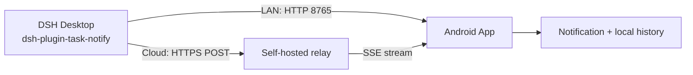
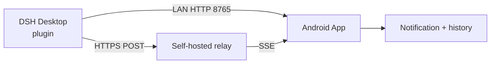

<p align="center">
  
</p>

<h1 align="center">DSH 任务通知</h1>

<p align="center">把 DSH 的任务完成、失败和授权请求推送到安卓手机</p>

<p align="center">
  <a href="https://github.com/1215chen/dsh-plugin-task-notify/releases/latest"></a>
  <a href="LICENSE"></a>
  
  
  
</p>

<p align="center"><b>中文</b> | <a href="#english">English</a></p>

> **AI 生成声明**：本项目的大部分代码、文档和测试由 AI 编程助手生成，维护者已进行审查、运行和修正。

DSH 任务通知是一个**自托管**的手机通知方案：DSH 每轮任务结束、执行失败，或弹出工具授权请求时，把结果推送到安卓手机。

它支持两条通道：

- **局域网直连**：同一 Wi-Fi 下 UDP 自动发现 + HTTP，无需公网。
- **云端中继**：通过你自己的 HTTPS 服务器转发，手机和电脑不在同一网络也能收到。

不依赖 FCM、ntfy、账号体系或第三方推送服务。



## 功能

| 功能 | 说明 |
|---|---|
| 任务通知 | 完成、失败、取消、中断、输出上限等回合结束状态 |
| 授权通知 | 监听 `approval/asked`，标题「需要授权」，正文包含工具名和原因 |
| 双通道 | 局域网直连和云端中继可同时开启 |
| 去重 | 同一 `payload.id` 在 10 分钟窗口内只保留一条通知和一条历史 |
| 本地历史 | 最近 50 条，点按查看详情，点通知自动定位 |
| 自托管云端 | 无第三方推送；SSE 断线重连、离线队列、`Last-Event-ID` 补发 |
| 安全 | 云端 HTTPS + Bearer Token；App 只信任内置 CA，插件固定同一 CA |

## 安装

### 环境要求

| 项目 | 要求 |
|---|---|
| 电脑 | Windows，已安装 DSH |
| 手机 | Android 8.0+（minSdk 26） |
| 局域网 | 手机和电脑在同一 Wi-Fi / 网段 |
| 云端（可选） | Ubuntu 等 Linux 服务器、可访问的 TCP 端口、HTTPS 证书 |

### 1. 下载

从 [Releases](https://github.com/1215chen/dsh-plugin-task-notify/releases/latest) 下载：

- `DSH-Task-Notify-1.2.1.apk`：安卓 App
- `dsh-plugin-task-notify-0.2.0.tgz`：DSH 插件
- `SHA256SUMS.txt`：校验值

### 2. 安装手机 App

1. 把 APK 传到手机并安装。系统提示「未知来源」时，允许当前文件管理器安装。
2. 打开 App，允许通知权限。
3. 接收服务默认启动，首页会显示手机在局域网中的地址，例如 `192.168.1.23:8765`。
4. 点「发送测试通知」，确认通知栏、声音和锁屏显示正常。
5. 建议把 App 加入电池白名单；**vivo / iQOO** 还必须允许「后台高耗电」，否则锁屏后服务会被系统冻结。

使用 ADB 安装：

```powershell
adb install -r release\DSH-Task-Notify-1.2.1.apk
```

### 3. 安装电脑端插件

```powershell
dsh plugin --profile desktop add "$env:USERPROFILE\Downloads\dsh-plugin-task-notify-0.2.0.tgz"
```

也可以在 DSH 的插件页面选择本地的 `dsh-plugin-task-notify-0.2.0.tgz`。

安装后确认 profile 的 `package.json` 包含：

```json
"dependencies": {
  "dsh-plugin-task-notify": "file:vendor/dsh-plugin-task-notify-0.2.0.tgz"
}
```

并且 `dsh.profile.bundles` 包含 `dsh-plugin-task-notify`。

### 4. 选择连接方式

#### 局域网（推荐先跑通）

1. 手机和电脑连接同一个 Wi-Fi。
2. 手机 App 保持「接收服务」开启。
3. 插件默认通过 UDP 8766 自动发现手机，无需填写 IP。

如果自动发现失败（路由器隔离广播、防火墙拦截或访客网络），在 profile 的
`cordis.patch.yml` 写死手机地址：

```yaml
- id: task-notify
  config:
    discover: false
    devices:
      - host: 192.168.1.23
        port: 8765
        name: 我的手机
```

#### 云端（跨网络）

先按 [完整配置过程](docs/setup.md) 部署中继，然后在 App 和插件里填写同一个设备 ID
和令牌。

App：**设置 → 云端中继**，填写服务器地址、设备 ID、令牌，保存。

插件 `cordis.patch.yml`：

```yaml
- id: task-notify
  config:
    cloud:
      url: https://<RELAY_HOST>:<RELAY_PORT>
      token: <TOKEN>
      device: my-phone
      caFile: C:/path/to/cloud-ca.pem
```

`caFile` 指向部署时生成的 CA 公钥。不要把 token、私钥或 keystore 提交到仓库。

### 5. 重启 DSH 并验证

插件只在 DSH 启动时加载。安装或修改配置后**重启 DSH**。

验证方式：

- 在对话里说：**「用 phone_notify 测试一下手机通知」**
- 或直接完成一轮任务，检查手机通知和 App「最近通知」
- 触发一次工具授权，确认收到「需要授权」通知

## 云端中继

云端是完全可选的。需要手机和电脑不在同一网络时，可以部署一个单用户中继：

- Node.js + systemd，无 Docker 依赖
- HTTPS + 自签名 CA（不需要域名，也不需要 80/443）
- 每台设备最近 200 条离线队列
- 手机 App 内置 CA 校验，插件用 `caFile` 固定校验
- 同时支持局域网 + 云端，手机端自动去重

部署、证书、令牌轮换和新增手机见：

- [完整配置过程](docs/setup.md)
- [云端中继说明](cloud/README.md)

## 界面

- 手机端 APP 设计依照谷歌 Material Design 3 界面设计语言。
- **通知页**只保留运行状态、接收地址、云端状态和最近通知，没有操作按钮。
- **设置页**集中所有操作：接收服务、发送测试、电池优化、后台运行、云端中继、
  端口/设备名/令牌、清空记录和关于。
- 固定深色界面，底部导航切换「通知 / 设置」。
- 应用图标使用 DSH 桌面端的鲸鱼图标；通知栏小图标为白色鲸鱼剪影。

## 项目结构

```text
.
├─ plugin/                DSH 插件源码与配置参考
├─ apk/                   Android 源码、资源、JVM 测试
├─ cloud/                 云端中继、CA、systemd/Docker 文件
├─ docs/
│  ├─ setup.md            从服务器到手机的完整配置过程
│  ├─ protocol.md         LAN HTTP、云端 SSE、通知 JSON
│  └─ device-test-report.md
├─ release/               已签名 APK、插件包、校验值
├─ build-apk.cmd          一键打包 APK
└─ 使用说明.md            中文使用与排错手册
```

## 从源码构建 APK

需要：

- JDK 17+
- Android build-tools 34
- Android platform 34
- Node.js 22+

仓库不包含 `_sdk/`、签名密钥或构建产物。准备 SDK 后：

```powershell
$env:DSH_KEYSTORE_PASSWORD = "your-keystore-password"
.\build-apk.cmd
```

首次构建会在 `apk\keystore\` 生成本地签名密钥；该目录已被 `.gitignore` 排除。
APK 输出到 `release\DSH-Task-Notify-1.2.1.apk`。

更详细的构建、测试和签名说明见 [apk/README.md](apk/README.md)。

## 兼容性与限制

- 已在 **vivo V2154A / Android 14** 上实测；其他 Android 版本和厂商 ROM 未逐一验证。
- vivo / iQOO 必须允许「后台高耗电」；否则锁屏后进程可能被冻结。
- 局域网模式要求手机和电脑在同一网段；云端模式需要手机能访问中继的 TCP 端口。
- 云端中继使用 SSE 长连接，不是 FCM：如果系统杀掉 App，通知会在下次连接时补发。
- 中继是单用户自托管服务，没有多租户、审计或限流，不要公开给不可信用户。
- 详细排错见 [使用说明](使用说明.md) 和 [设备测试报告](docs/device-test-report.md)。

## 安全

- 局域网默认不校验令牌；在不完全可信的 Wi-Fi 中，请在 App 和插件设置相同的 `token`。
- 云端使用 HTTPS + Bearer Token；App 只信任内置 CA，插件通过 `caFile` 固定校验。
- 令牌泄露后，修改服务器 `/etc/dsh-notify.env` 的 `TOKEN`，重启中继，再更新 App 和插件。
- 通知正文可能包含工作内容；可在插件配置中设置 `includePreview: false`。

## 文档

- [使用说明](使用说明.md) — 安装、配置、故障排查、卸载、测试
- [完整配置过程](docs/setup.md) — Ubuntu、Node、CA、systemd、NAT、插件、App
- [云端中继](cloud/README.md) — 运维、证书、队列、令牌
- [插件配置参考](plugin/README.zh.md) — 全部字段、通知规则、安全
- [通信协议](docs/protocol.md) — LAN HTTP、云端 SSE、通知 JSON
- [真机测试报告](docs/device-test-report.md) — vivo V2154A / Android 14
- [安卓工程](apk/README.md) — 源码结构、构建、测试、签名

## 参与贡献

欢迎提交 Issue 和 Pull Request：

- Bug 请附上系统版本、App 版本、复现步骤和相关日志。
- 不要提交 token、CA 私钥、签名 keystore、服务器 IP 或本机用户路径。
- 修改插件或 App 后，请至少跑一遍相关测试：

```powershell
# 插件集成测试
node apk/test/plugin-integration.mjs

# 云端中继协议测试（需要本地 relay）
node cloud/test-relay.mjs
```

## AI 生成声明

本项目的大部分代码、文档、测试和发布说明由 AI 编程助手生成，维护者负责需求、审查、真机测试和修正。

AI 输出可能包含错误、过时信息或不适合生产环境的默认值。使用前请自行审查，尤其是：

- 云端部署、证书和令牌配置
- Android 签名密钥与发布流程
- 局域网/云端的安全边界

如果你发现 AI 生成内容中的问题，欢迎提交 Issue 或 Pull Request。

## 许可

插件与 App 源码采用 [MIT License](LICENSE)。Android SDK 工具仅用于本地构建，不随交付物分发。

---

## English

> **AI-generated disclosure**: Most of the code, documentation and tests in this
> project were generated by AI coding assistants, then reviewed, run and corrected by the
> maintainer.

Push DSH task completion, failure and **approval requests** to an Android phone. The
project is self-hosted and has no dependency on FCM, ntfy, an account system or a
third-party push provider.

- **LAN**: UDP discovery + HTTP on the same Wi-Fi.
- **Cloud relay**: HTTPS forwarding through your own server, with SSE and an offline queue.



### Features

| Feature | Description |
|---|---|
| Task events | Completed, failed, cancelled, interrupted, token limit |
| Approval | `approval/asked` → “Approval required” with tool name and reason |
| Dual channel | LAN and cloud can be enabled together |
| Dedupe | The same `payload.id` is delivered once in a 10-minute window |
| History | Last 50 notifications, tap to view details |
| Self-hosted cloud | SSE reconnect, offline queue and `Last-Event-ID` replay |
| Security | HTTPS + Bearer token; App trusts an embedded CA, plugin pins the same CA |

### Install

1. Download the latest APK and plugin from
   [Releases](https://github.com/1215chen/dsh-plugin-task-notify/releases/latest).
2. Install the APK, grant notification permission and allow background activity.
   On vivo/iQOO also allow high background power consumption.
3. Install the desktop plugin:

   ```powershell
   dsh plugin --profile desktop add "$env:USERPROFILE\Downloads\dsh-plugin-task-notify-0.2.0.tgz"
   ```

4. Keep the phone and desktop on the same Wi-Fi for LAN. If UDP discovery is blocked,
   pin the phone in `cordis.patch.yml`:

   ```yaml
   - id: task-notify
     config:
       discover: false
       devices:
         - host: 192.168.1.23
           port: 8765
   ```

5. For cloud, configure both sides. App: **Settings → Cloud relay**. Plugin:

   ```yaml
   - id: task-notify
     config:
       cloud:
         url: https://<RELAY_HOST>:<RELAY_PORT>
         token: <TOKEN>
         device: my-phone
         caFile: C:/path/to/cloud-ca.pem
   ```

6. Restart DSH. Verify with the `phone_notify` tool or by completing a task.

Detailed server/CA/token setup: [docs/setup.md](docs/setup.md). Relay operations:
[cloud/README.md](cloud/README.md).

### Build

Requirements: JDK 17+, Android build-tools 34, platform android-34 and Node.js 22+.

```powershell
$env:DSH_KEYSTORE_PASSWORD = "your-keystore-password"
.\build-apk.cmd
```

The APK is written to `release\DSH-Task-Notify-1.2.1.apk`. The signing key and `_sdk/`
are git-ignored.

### Compatibility and security

- Tested on vivo V2154A / Android 14; other ROMs are not verified.
- The cloud relay is a single-user service without multi-tenant isolation, auditing or
  rate limiting. Do not expose it to untrusted users.
- LAN uses an optional shared token. Cloud uses HTTPS + Bearer token and CA pinning.
- Notification bodies can contain work content; set `includePreview: false` if needed.
- SSE is not FCM: if the OS kills the app, messages are replayed on the next connection.

### Documentation

- [Chinese usage guide](使用说明.md)
- [Full setup guide](docs/setup.md)
- [Cloud relay](cloud/README.md)
- [Plugin reference](plugin/README.zh.md)
- [Protocol](docs/protocol.md)
- [Device test report](docs/device-test-report.md)

### AI-generated disclosure

Most of the code, documentation, tests and release notes were generated by AI coding
assistants. The maintainer owns the requirements, review, real-device testing and fixes.

AI output can contain mistakes, stale information or unsafe defaults. Review it before
production use, especially cloud deployment, certificates, tokens, Android signing and
the security boundary between LAN and cloud.

Issues and pull requests that correct AI-generated content are welcome.

### License

MIT. Android SDK tools are only used for local builds and are not distributed.
