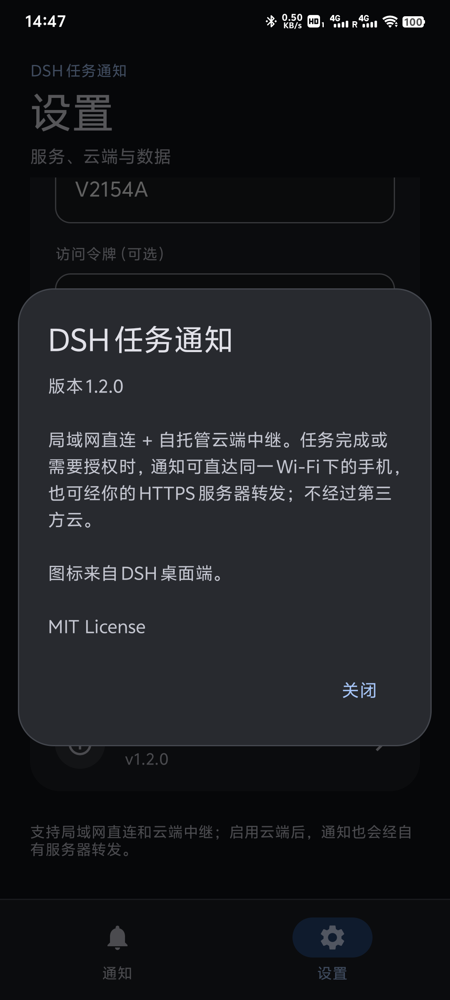

# DSH 任务通知

**中文** | [English](#english)

本项目大量代码由AI生成

把 DSH 的任务完成、失败和**需要授权**推送到安卓手机。支持两种通道：

- **局域网直连**：同一 Wi-Fi 下 UDP 自动发现 + HTTP，无需公网。
- **云端中继**：通过你自己的云服务器 HTTPS 转发，手机和电脑不在同一网络也能收到。

不依赖 FCM、ntfy、账号或第三方推送服务。

```text
┌─────────────────────────────┐      UDP 8766 / HTTP 8765（局域网）     ┌──────────────────────────────┐
│ DSH Desktop                 │ ─────────────────────────────────────▶ │ DSH 任务通知 App（安卓）      │
│ dsh-plugin-task-notify      │                                        │ 前台服务 + 通知 + 历史        │
│ turn/end + approval/asked   │ ── HTTPS POST ──▶ 云中继 ── SSE ─────▶ │ 局域网 / 云端双通道           │
└─────────────────────────────┘                                        └──────────────────────────────┘
```

## 交付物

| 文件 | 说明 |
|---|---|
| [`release/DSH-Task-Notify-1.2.1.apk`](release/DSH-Task-Notify-1.2.1.apk) | 安卓安装包（minSdk 26 / targetSdk 34） |
| [`release/dsh-plugin-task-notify-0.2.0.tgz`](release/dsh-plugin-task-notify-0.2.0.tgz) | 电脑端 DSH 插件包 |
| [`plugin/`](plugin/) | 插件源码与配置说明 |
| [`apk/`](apk/) | 安卓 App 源码、资源、JVM 测试 |
| [`cloud/`](cloud/) | 云端中继源码、部署说明、CA |
| [`build-apk.cmd`](build-apk.cmd) / [`build-apk.ps1`](build-apk.ps1) | 可复现的 APK 打包脚本 |
| [`使用说明.md`](使用说明.md) | 安装、配对、云端配置、故障排查 |
| [`docs/protocol.md`](docs/protocol.md) | 两端通信协议 |
| [`release/SHA256SUMS.txt`](release/SHA256SUMS.txt) | 交付物校验值 |

## 快速开始

1. 安装 `DSH-Task-Notify-1.2.1.apk`，允许通知权限。
2. 局域网模式：手机和电脑连接同一 Wi-Fi，打开「接收服务」。
3. 云端模式：设置 → 云端中继，填写服务器地址、设备 ID、令牌并保存。
4. 插件已经写入 DSH 的 `desktop` profile（见下节）。
5. 之后每轮任务完成/失败，以及 DSH 弹出授权请求时，都会收到通知。

## 安装教程

### 1. 手机端

1. 下载 [`release/DSH-Task-Notify-1.2.1.apk`](release/DSH-Task-Notify-1.2.1.apk)。
2. 传到手机后点击安装；系统提示「未知来源」时允许当前文件管理器安装。
   USB 调试也可用：

   ```powershell
   adb install -r release\DSH-Task-Notify-1.2.1.apk
   ```

3. 打开 App，允许通知权限。接收服务默认启动，首页状态卡会显示手机在局域网中的地址，
   例如 `192.168.1.23:8765`。
4. 点「发送测试通知」，确认通知栏、声音和锁屏显示正常。
5. 建议把 App 加入电池白名单；vivo/iQOO 还必须允许「后台高耗电」，否则锁屏后服务会被冻结。

### 2. 电脑端插件

1. 确认 DSH 已安装并能正常启动。
2. 安装插件包（二选一）：

   ```powershell
   dsh plugin --profile desktop add D:\path\to\dsh-plugin-task-notify-0.2.0.tgz
   ```

   或在 DSH 插件页面选择本地的 `dsh-plugin-task-notify-0.2.0.tgz`。

3. 确认 profile 的 `package.json` 里有：

   ```json
   "dependencies": {
     "dsh-plugin-task-notify": "file:vendor/dsh-plugin-task-notify-0.2.0.tgz"
   }
   ```

   以及 `dsh.profile.bundles` 包含 `dsh-plugin-task-notify`。

4. 局域网模式无需额外配置，插件会自动发现同一 Wi-Fi 下的手机。自动发现失败时，
   在 profile 的 `cordis.patch.yml` 写死手机 IP：

   ```yaml
   - id: task-notify
     config:
       discover: false
       devices:
         - host: 192.168.1.23
           port: 8765
           name: 我的手机
   ```

5. 云端模式在同一个 `cordis.patch.yml` 加：

   ```yaml
   - id: task-notify
     config:
       cloud:
         url: https://YOUR_SERVER_IP:56159
         token: <TOKEN>
         device: my-phone
         caFile: C:/path/to/cloud-ca.pem
   ```

6. **重启 DSH**。插件只在启动时加载；重启后可在对话里说
   **「用 phone_notify 测试一下手机通知」** 验证。

### 3. 云端（可选）

不配置云端时，手机和电脑在同一 Wi-Fi 即可。需要跨网络时：

1. 按 [完整配置过程](docs/setup.md) 在服务器部署中继、CA 和令牌。
2. 在 App 设置 → 云端中继填入 URL、设备 ID、令牌，保存。
3. 在插件 `cloud` 配置里填同一个设备 ID 和令牌，重启 DSH。
4. 首页出现「云端已连接」后，从外网触发一轮任务测试。

### 4. 从源码构建 APK（可选）

需要 JDK 17+、Android build-tools 34、platform android-34 和 Node 22。
仓库不包含 `_sdk/` 与签名密钥，需自行准备：

```powershell
$env:DSH_KEYSTORE_PASSWORD = "your-keystore-password"
.\build-apk.cmd
```

首次构建会在 `apk\keystore\` 生成本地签名密钥；该目录已被 `.gitignore` 排除，不要提交。
APK 输出到 `release\DSH-Task-Notify-1.2.1.apk`。

## 界面

- 手机端 APP 设计依照谷歌 Material Design 3 界面设计语言。
- **通知页**只保留运行状态、接收地址、云端连接状态和最近通知，没有操作按钮。
- **设置页**集中所有操作：接收服务、发送测试、电池优化、后台运行设置、云端中继、
  端口/设备名/令牌、清空记录和关于。
- 固定深色界面，底部导航切换「通知 / 设置」。
- 应用图标使用 DSH 桌面端的鲸鱼图标；通知栏小图标为白色鲸鱼剪影。

## 云端中继

已部署在 Ubuntu 24.04 云服务器，NAT 高端口 + 自签名证书，App 内置 CA 校验：

```text
https://YOUR_SERVER_IP:56159
```

部署、运维、令牌和新增手机的说明见 [cloud/README.md](cloud/README.md)。当前实例不需要
域名，也不需要开放 80/443。

## 插件安装状态

插件已经写入：

```text
%USERPROFILE%\.dsh\profiles\desktop\
  package.json                  dsh-plugin-task-notify: file:vendor/dsh-plugin-task-notify-0.2.0.tgz
  vendor\dsh-plugin-task-notify-0.2.0.tgz
  node_modules\dsh-plugin-task-notify\
```

`dsh.profile.bundles` 已包含 `dsh-plugin-task-notify`，DSH 启动时会自动加载。

> 当前正在运行的 DSH 进程仍加载旧版插件。磁盘上已经是 **0.2.0**（云端 + 授权通知）；
> 重启一次 DSH 后生效。重启前的局域网任务完成通知仍可用，但授权通知和云端发送不会由
> 当前进程产生。

## 文档

- [使用说明](使用说明.md) — 安装、云端配置、故障排查、构建测试
- [完整配置过程](docs/setup.md) — 从 Ubuntu 服务器、CA、令牌到插件和 App
- [云端中继部署](cloud/README.md) — 服务器运维、证书、令牌、队列
- [插件配置参考](plugin/README.zh.md) — 全部字段、通知规则、安全说明
- [通信协议](docs/protocol.md) — UDP 发现、HTTP 接口、SSE、通知 JSON
- [真机测试报告](docs/device-test-report.md) — vivo V2154A / Android 14 实测记录
- [安卓工程说明](apk/README.md) — 源码结构、构建、测试、签名

## 已验证（真机 + JVM）

- 安卓接收核心（JSON / HTTP / UDP / 令牌 / 错误处理）桌面 JVM **19 项测试通过**。
- 插件集成测试（局域网）**6 项通过**；云端中继协议、SSE 重放、离线队列和插件云端投递
  另有测试脚本。
- **vivo V2154A / Android 14 真机**：安装、前台服务、`/ping`、通知渠道、通知中心、
  点按定位历史、云端 SSE、自签名 CA 校验、授权通知、设置页开关全部实测通过。
- 云端链路实测：插件 0.2.0 → `YOUR_SERVER_IP:56159` → 手机 SSE → 通知/历史。
- 双通道去重：同一 `payload.id` 同时从局域网和云端到达时，10 分钟窗口内只保留一条通知和一条历史。
- APK 已通过 `apksigner verify`（v2 + v3）、`zipalign`、`aapt2 dump badging`。



## 仍需注意

- vivo / iQOO 必须额外允许「后台高耗电」，否则锁屏后会被系统冻结；见
  [使用说明 3.1](使用说明.md#31-vivo--iqoo-必做本机实测)。
- 局域网模式要求手机与电脑同网段；云端模式不受此限制，但手机需要能访问云服务器的
  TCP 56159。
- 云端是单用户自托管中继，没有多租户、审计或限流；不要公开给不可信用户。
- 仅在一台 vivo V2154A / Android 14 上实测；其他 ROM 的后台策略未逐一验证。
- 运行中的 DSH 进程仍加载旧插件；重启 DSH 后加载 0.2.0。

## 安全提示

- 局域网默认不校验令牌；需要隔离时在 App 和插件里设置同一个 `token`。
- 云端使用 HTTPS + Bearer Token；App 只信任内置的自签名 CA，插件通过 `caFile` 固定校验。
- 令牌泄露后，修改服务器 `/etc/dsh-notify.env` 的 `TOKEN`，重启服务，再更新 App 和插件。
- 通知正文可能包含工作内容；可在插件配置中设置 `includePreview: false`。

## 许可

插件与 App 源码为 MIT。Android SDK 工具仅用于本地构建，不随交付物分发。

---

## English

Much of the code in this project was generated by AI.

Push DSH task completion, failure and **approval requests** to an Android phone. Two
transport channels are supported:

- **LAN**: UDP discovery + HTTP on the same Wi-Fi, no public network required.
- **Cloud relay**: HTTPS forwarding through your own server, so the phone and desktop
  do not need to share a network.

No FCM, ntfy, account or third-party push service.

### Deliverables

| File | Description |
|---|---|
| [`release/DSH-Task-Notify-1.2.1.apk`](release/DSH-Task-Notify-1.2.1.apk) | Android APK (minSdk 26 / targetSdk 34) |
| [`release/dsh-plugin-task-notify-0.2.0.tgz`](release/dsh-plugin-task-notify-0.2.0.tgz) | DSH desktop plugin |
| [`plugin/`](plugin/) | Plugin source and configuration |
| [`apk/`](apk/) | Android source, resources and JVM tests |
| [`cloud/`](cloud/) | Relay source, deployment files and CA |
| [`build-apk.cmd`](build-apk.cmd) / [`build-apk.ps1`](build-apk.ps1) | Reproducible APK build |
| [`使用说明.md`](使用说明.md) | Chinese installation/configuration/troubleshooting guide |
| [`docs/setup.md`](docs/setup.md) | Full setup from Ubuntu and CA to plugin and App |
| [`docs/protocol.md`](docs/protocol.md) | LAN and cloud protocol |
| [`release/SHA256SUMS.txt`](release/SHA256SUMS.txt) | Checksums |

### Quick start

1. Install `DSH-Task-Notify-1.2.1.apk` and grant notification permission.
2. LAN: connect the phone and desktop to the same Wi-Fi and enable the receiver.
3. Cloud: Settings → Cloud relay, enter server URL, device ID and token, then save.
4. The plugin is installed into the DSH `desktop` profile (see below).
5. Notifications arrive on task completion/failure and when DSH asks for approval.

### Installation

#### Phone

1. Download [`release/DSH-Task-Notify-1.2.1.apk`](release/DSH-Task-Notify-1.2.1.apk) and install it.
   With ADB:

   ```powershell
   adb install -r release\DSH-Task-Notify-1.2.1.apk
   ```

2. Open the app and allow notifications. The receiver starts by default; the status card
   shows the phone's LAN address (for example `192.168.1.23:8765`).
3. Tap **Send test notification** and confirm sound/lock-screen display.
4. Allow background activity. On vivo/iQOO also allow **high background power consumption**,
   otherwise the service is frozen when the screen is off.

#### Desktop plugin

1. Install the plugin from the release tarball:

   ```powershell
   dsh plugin --profile desktop add D:\path\to\dsh-plugin-task-notify-0.2.0.tgz
   ```

   Or pick `dsh-plugin-task-notify-0.2.0.tgz` in the DSH plugin page.

2. Ensure the profile `package.json` has
   `dsh-plugin-task-notify: file:vendor/dsh-plugin-task-notify-0.2.0.tgz` and
   `dsh.profile.bundles` contains `dsh-plugin-task-notify`.

3. LAN works without configuration. If UDP discovery is blocked, pin the phone in
   `cordis.patch.yml`:

   ```yaml
   - id: task-notify
     config:
       discover: false
       devices:
         - host: 192.168.1.23
           port: 8765
           name: My phone
   ```

4. For cloud, add:

   ```yaml
   - id: task-notify
     config:
       cloud:
         url: https://YOUR_SERVER_IP:56159
         token: <TOKEN>
         device: my-phone
         caFile: C:/path/to/cloud-ca.pem
   ```

5. **Restart DSH**. The plugin loads at startup. Verify with the
   `phone_notify` tool or by triggering a task.

#### Build from source (optional)

JDK 17+, Android build-tools 34, platform android-34 and Node 22 are required. The
repository does not include `_sdk/` or a signing key:

```powershell
$env:DSH_KEYSTORE_PASSWORD = "your-keystore-password"
.\build-apk.cmd
```

The first build creates a local key under `apk\keystore\`, which is git-ignored. The APK
is written to `release\DSH-Task-Notify-1.2.1.apk`.

### UI

- The mobile app follows Google Material Design 3.
- **Notifications** page: runtime status, LAN address, cloud status and recent history.
  No action buttons.
- **Settings** page: receiver switch, test notification, battery optimization,
  background guide, cloud relay, port/device/token, clear history and About.
- Dark UI with bottom navigation.
- The launcher icon is the DSH desktop whale; the notification small icon is a white
  whale silhouette.


### Cloud relay

Deployed on Ubuntu 24.04 with a NAT high port and a self-signed certificate pinned by
the App:

```text
https://YOUR_SERVER_IP:56159
```

See [docs/setup.md](docs/setup.md) and [cloud/README.md](cloud/README.md) for deployment,
operations, tokens and adding another phone. No domain or ports 80/443 are required.

### Plugin installation

```text
%USERPROFILE%\.dsh\profiles\desktop\
  package.json                  dsh-plugin-task-notify: file:vendor/dsh-plugin-task-notify-0.2.0.tgz
  vendor\dsh-plugin-task-notify-0.2.0.tgz
  node_modules\dsh-plugin-task-notify\
```

`dsh.profile.bundles` includes `dsh-plugin-task-notify`. The running DSH process still
has the old plugin loaded; restart DSH once to activate 0.2.0 (cloud + approval).

### Documentation

- [Setup guide](docs/setup.md) — full server/CA/token/plugin/App procedure
- [Cloud relay](cloud/README.md) — operations, certificates, queues
- [Plugin reference](plugin/README.zh.md) — every field, notification rules, security
- [Protocol](docs/protocol.md) — LAN HTTP, cloud SSE, payload
- [Device test report](docs/device-test-report.md) — vivo V2154A / Android 14
- [Android project](apk/README.md) — structure, build, tests, signing

> Most detailed docs are currently in Chinese. The setup guide commands are
> copy-paste ready; English translation can be added on request.

### Verified

- Android receiver core: **19 JVM tests passed**.
- Plugin LAN integration: **6 tests passed**; cloud relay protocol, SSE replay,
  offline queue and plugin cloud delivery have separate tests.
- Real device: vivo V2154A / Android 14 — install, foreground service, `/ping`,
  notification channel, history deep link, cloud SSE, pinned CA, approval notification
  and settings switches all verified.
- Cloud path verified end-to-end: plugin 0.2.0 → `YOUR_SERVER_IP:56159` → phone SSE.
- Duplicate suppression: the same `payload.id` arriving over LAN and cloud produces only
  one notification and one history entry within a 10-minute window.
- APK passes `apksigner verify` (v2 + v3), `zipalign` and `aapt2 dump badging`.

### Notes

- vivo/iQOO needs "allow high background power consumption" or the service is frozen
  when the screen is off.
- LAN mode requires the same subnet; cloud mode requires outbound access to TCP 56159.
- The relay is a single-user self-hosted service without multi-tenant isolation,
  auditing or rate limiting. Do not expose it to untrusted users.
- Tested on one vivo V2154A / Android 14 device only.

### Security

- LAN mode does not require a token by default; set the same `token` in the App and
  plugin if the Wi-Fi is untrusted.
- Cloud mode uses HTTPS + Bearer token. The App trusts only the embedded CA; the plugin
  pins the same CA through `caFile`.
- Rotate the token in `/etc/dsh-notify.env`, restart the relay, then update the App and
  plugin.
- Notification bodies may contain work content; set `includePreview: false` if needed.

### License

Plugin and App source are MIT. Android SDK tools are only used for local builds and are
not distributed.

