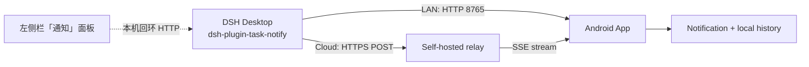
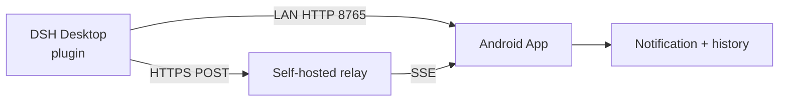

<p align="center">
  
</p>

<h1 align="center">DSH 任务通知</h1>

<p align="center">把 DSH 的任务完成、失败和授权请求推送到安卓手机，并在 DSH 左侧栏里配置</p>

<p align="center">
  <a href="https://github.com/1215chen/dsh-plugin-task-notify/releases/latest"></a>
  <a href="LICENSE"></a>
  
  
  
</p>

<p align="center"><b>中文</b> | <a href="#english">English</a></p>

> **AI 生成声明**：本项目的大部分代码、文档和测试由 AI 编程助手生成，维护者已进行审查、运行和修正。

DSH 任务通知是一个**自托管**的手机通知方案：DSH 每轮任务结束、执行失败，或弹出工具授权请求时，把结果推送到安卓手机。

两条通道可以同时开启：

- **局域网直连**：同一 Wi-Fi 下 UDP 自动发现 + HTTP，无需公网。
- **云端中继**：通过你自己的 HTTPS 服务器转发，手机和电脑不在同一网络也能收到。

不依赖 FCM、ntfy、账号体系或第三方推送服务。



## 功能

| 功能 | 说明 |
|---|---|
| 任务通知 | 完成、失败、取消、中断、输出上限等回合结束状态 |
| 授权通知 | 监听 `approval/asked`，标题「需要授权」，正文包含工具名和原因 |
| 双通道 | 局域网直连和云端中继可同时开启，任一路成功即视为送达 |
| **左侧栏设置面板** | DSH 左侧栏新增「通知」入口，可直接改局域网令牌、云服务器地址/设备/令牌、证书指纹，并可发送测试通知 |
| 去重 | 同一 `payload.id` 在 10 分钟窗口内只保留一条通知和一条历史 |
| 本地历史 | 最近 50 条，点按查看详情，点通知自动定位 |
| 自托管云端 | 无第三方推送；SSE 断线重连、离线队列、`Last-Event-ID` 补发 |
| **证书信任** | 手机按「首次确认指纹」固定服务器证书，不需要重新打包 APK；插件可用指纹或 CA 文件校验同一张证书 |

## 安装

### 环境要求

| 项目 | 要求 |
|---|---|
| 电脑 | Windows，已安装 DSH |
| 手机 | Android 8.0+（minSdk 26） |
| 局域网 | 手机和电脑在同一 Wi-Fi / 网段 |
| 云端（可选） | Ubuntu 等 Linux 服务器、可访问的 TCP 端口、HTTPS 证书 |

### 1. 下载

从 [Releases](https://github.com/1215chen/dsh-plugin-task-notify/releases/latest) 下载：

- `DSH-Task-Notify-1.2.2.apk`：安卓 App
- `dsh-plugin-task-notify-1.2.2.tgz`：DSH 插件
- `SHA256SUMS.txt`：校验值

### 2. 安装手机 App

1. 把 APK 传到手机并安装。系统提示「未知来源」时，允许当前文件管理器安装。
2. 打开 App，允许通知权限。
3. 接收服务默认启动，首页会显示手机在局域网中的地址，例如 `192.168.1.23:8765`。
4. 点「发送测试通知」，确认通知栏、声音和锁屏显示正常。
5. 建议把 App 加入电池白名单；**vivo / iQOO** 还必须允许「后台高耗电」，否则锁屏后服务会被系统冻结。

使用 ADB 安装：

```powershell
adb install -r release\DSH-Task-Notify-1.2.2.apk
```

> **从 1.2.1 升级**：1.2.2 使用了新的签名密钥，Android 不允许覆盖安装不同签名的 APK。请先卸载旧版（会清空 App 内的历史与设置），再安装 1.2.2。签名密钥与密码在本地 `apk\keystore\` 和 `apk\keystore\password.txt`，已被 `.gitignore` 排除，请自行备份。

### 3. 安装电脑端插件

```powershell
dsh plugin --profile desktop add "$env:USERPROFILE\Downloads\dsh-plugin-task-notify-1.2.2.tgz"
```

也可以在 DSH 的插件页面选择本地的 `dsh-plugin-task-notify-1.2.2.tgz`。

安装后确认 profile 的 `package.json` 包含：

```json
"dependencies": {
  "dsh-plugin-task-notify": "file:vendor/dsh-plugin-task-notify-1.2.2.tgz"
}
```

并且 `dsh.profile.bundles` 包含 `dsh-plugin-task-notify`。

### 4. 打开左侧栏设置

1. 重启 DSH（插件与它的浏览器端界面只在启动时加载）。
2. 左侧栏底部会出现 **通知** 入口；点开后是设置页。
3. 局域网：直接在「局域网」卡片里填访问令牌（可点「生成」）。
4. 云端：填服务器地址、设备 ID、访问令牌，点「获取指纹」拿到服务器证书的 SHA-256，再点「使用此指纹」并保存。
5. 保存后立即生效，不需要重启。

设置保存在 `%USERPROFILE%\.dsh\storages\task-notify\settings.json`，只在**本机回环地址**可读可写；它覆盖 profile 里的同名配置，删除该文件即可回到 `cordis.patch.yml` 的值。

### 5. 验证

- 在设置页点「发送测试通知」，或对助手说：「用 phone_notify 测试一下手机通知」。
- 完成一轮任务，检查手机通知和 App「最近通知」。
- 触发一次工具授权，确认收到「需要授权」通知。

## 云端中继

云端是完全可选的。需要手机和电脑不在同一网络时，可以部署一个单用户中继：

- Node.js + systemd，无 Docker 依赖
- HTTPS + 自签名证书（不需要域名，也不需要 80/443）
- 每台设备最近 200 条离线队列
- 手机 App 首次连接时固定服务器证书指纹，之后指纹变化会拒绝连接
- 插件用同一指纹（或 CA 文件）校验中继
- 同时支持局域网 + 云端，手机端自动去重

部署、证书、令牌轮换和新增手机见：

- [完整配置过程](docs/setup.md)
- [云端中继说明](cloud/README.md)

## 界面

- 手机端 APP 依照谷歌 Material Design 3 界面设计语言。
- DSH 端新增左侧栏「通知」面板，风格跟随 DSH 主题（深色/浅色）。
- **通知页**只保留运行状态、接收地址、云端状态和最近通知，没有操作按钮。
- **设置页**集中所有操作：接收服务、发送测试、电池优化、后台运行、云端中继、
  端口/设备名/令牌、清空记录和关于。
- 固定深色界面，底部导航切换「通知 / 设置」。
- 应用图标使用 DSH 桌面端的鲸鱼图标；通知栏小图标为白色鲸鱼剪影。

## 项目结构

```text
.
├─ plugin/                DSH 插件源码（宿主 lib/index.js + 浏览器 lib/client.js）
├─ apk/                   Android 源码、资源、JVM 测试
├─ cloud/                 云端中继、systemd/Docker 配置
├─ docs/
│  ├─ setup.md            从服务器到手机的完整配置过程
│  ├─ protocol.md         LAN HTTP、云端 SSE、通知 JSON
│  └─ device-test-report.md
├─ release/               已签名 APK、插件包、校验值
├─ build-apk.cmd          一键打包 APK
└─ 使用说明.md            中文使用与排错手册
```

## 从源码构建 APK

需要：

- JDK 17+（脚本显式用 `-encoding UTF-8` 编译源码）
- Android build-tools 34
- Android platform 34
- Node.js 22+

仓库不包含 `_sdk/`、签名密钥或构建产物。准备 SDK 后：

```powershell
$env:DSH_KEYSTORE_PASSWORD = "your-keystore-password"
.\build-apk.cmd
```

首次构建会在 `apk\keystore\` 生成本地签名密钥；该目录已被 `.gitignore` 排除。
APK 输出到 `release\DSH-Task-Notify-1.2.2.apk`。

更详细的构建、测试和签名说明见 [apk/README.md](apk/README.md)。

## 兼容性与限制

- 已在 **vivo V2154A / Android 14** 上实测；其他 Android 版本和厂商 ROM 未逐一验证。
- vivo / iQOO 必须允许「后台高耗电」；否则锁屏后进程可能被冻结。
- 局域网模式要求手机和电脑在同一网段；云端模式需要手机能访问中继的 TCP 端口。
- 云端中继使用 SSE 长连接，不是 FCM：如果系统杀掉 App，通知会在下次连接时补发。
- 中继是单用户自托管服务，没有多租户、审计或限流，不要公开给不可信用户。
- 详细排错见 [使用说明](使用说明.md) 和 [设备测试报告](docs/device-test-report.md)。

## 安全

- 局域网默认不校验令牌；在不完全可信的 Wi-Fi 中，请在 App 和左侧栏面板里设置相同的 `token`。
- 云端只接受 `https://`（只有本机回环地址允许 `http://`）；App 已关闭明文流量。
- 云端证书：手机首次连接时会展示服务器证书 SHA-256，确认后固定；插件用 `cloud.fingerprint` 或 `cloud.caFile` 校验同一张证书。
- 令牌泄露后，修改服务器 `/etc/dsh-notify.env` 的 `TOKEN`，重启中继，再在 DSH 左侧栏和 App 里更新。
- 通知正文可能包含工作内容；可在插件配置中设置 `includePreview: false`。

## 文档

- [使用说明](使用说明.md) — 安装、配置、故障排查、卸载、测试
- [完整配置过程](docs/setup.md) — Ubuntu、Node、证书、systemd、NAT、插件、App
- [云端中继](cloud/README.md) — 运维、证书、队列、令牌
- [插件配置参考](plugin/README.zh.md) — 全部字段、通知规则、设置面板、安全
- [通信协议](docs/protocol.md) — LAN HTTP、云端 SSE、通知 JSON、信任模型
- [真机测试报告](docs/device-test-report.md) — vivo V2154A / Android 14
- [安卓工程](apk/README.md) — 源码结构、构建、测试、签名

## 参与贡献

欢迎提交 Issue 和 Pull Request：

- Bug 请附上系统版本、App 版本、复现步骤和相关日志。
- 不要提交 token、证书私钥、签名 keystore、服务器 IP 或本机用户路径。
- 修改插件或 App 后，请至少跑一遍相关测试：

```powershell
# 插件集成测试（需要先启动 JVM 接收端）
node apk/test/plugin-integration.mjs

# 设置面板 API 测试（纯 Node）
node plugin/test/settings-api.mjs

# 云端中继协议测试（需要本地 relay）
node cloud/test-relay.mjs
```

## AI 生成声明

本项目的大部分代码、文档、测试和发布说明由 AI 编程助手生成，维护者负责需求、审查、真机测试和修正。

AI 输出可能包含错误、过时信息或不适合生产环境的默认值。使用前请自行审查，尤其是：

- 云端部署、证书和令牌配置
- Android 签名密钥与发布流程
- 局域网/云端的安全边界

如果你发现 AI 生成内容中的问题，欢迎提交 Issue 或 Pull Request。

## 许可

插件与 App 源码采用 [MIT License](LICENSE)。Android SDK 工具仅用于本地构建，不随交付物分发。

---

## English

> **AI-generated disclosure**: Most of the code, documentation and tests in this
> project were generated by AI coding assistants, then reviewed, run and corrected by the
> maintainer.

Push DSH task completion, failure and **approval requests** to an Android phone. The
desktop plugin also adds a **Notifications** entry to the DSH left sidebar where the LAN
token and the cloud relay settings can be edited without touching YAML.

- **LAN**: UDP discovery + HTTP on the same Wi-Fi.
- **Cloud relay**: HTTPS forwarding through your own server, with SSE and an offline queue.
- **Certificate trust**: the phone pins the relay's leaf certificate on first use, so a
  self-hosted relay works with the released APK; the plugin pins the same SHA-256 (or a
  CA file). Plain `http://` is refused except for loopback testing.



### Features

| Feature | Description |
|---|---|
| Task events | Completed, failed, cancelled, interrupted, token limit |
| Approval | `approval/asked` → “Approval required” with tool name and reason |
| Dual channel | LAN and cloud can be enabled together |
| Sidebar settings | LAN token, relay URL/device/token, certificate fingerprint, test notification |
| Dedupe | The same `payload.id` is delivered once in a 10-minute window |
| History | Last 50 notifications, tap to view details |
| Self-hosted cloud | SSE reconnect, offline queue and `Last-Event-ID` replay |
| Trust | Phone pins the relay certificate; plugin pins the same fingerprint or CA file |

### Install

1. Download the latest APK and plugin from
   [Releases](https://github.com/1215chen/dsh-plugin-task-notify/releases/latest).
2. Install the APK, grant notification permission and allow background activity.
   On vivo/iQOO also allow high background power consumption.
3. Install the desktop plugin:

   ```powershell
   dsh plugin --profile desktop add "$env:USERPROFILE\Downloads\dsh-plugin-task-notify-1.2.2.tgz"
   ```

4. Restart DSH. The left sidebar now has a **Notifications** entry (通知).
5. LAN only needs the phone and desktop on the same Wi-Fi. For cloud, fill in the relay
   URL, device id, token, click **Get fingerprint**, then **Use this fingerprint** and save.
6. Verify with the **Send test notification** button or the `phone_notify` tool.

Detailed server/CA/token setup: [docs/setup.md](docs/setup.md). Relay operations:
[cloud/README.md](cloud/README.md).

### Build

Requirements: JDK 17+, Android build-tools 34, platform android-34 and Node.js 22+.

```powershell
$env:DSH_KEYSTORE_PASSWORD = "your-keystore-password"
.\build-apk.cmd
```

The APK is written to `release\DSH-Task-Notify-1.2.2.apk`. The signing key and `_sdk/`
are git-ignored. Version 1.2.2 uses a new signing key, so a 1.2.1 installation must be
removed first (Android refuses an update signed by a different key).

### Compatibility and security

- Tested on vivo V2154A / Android 14; other ROMs are not verified.
- The cloud relay is a single-user service without multi-tenant isolation, auditing or
  rate limiting. Do not expose it to untrusted users.
- LAN uses an optional shared token. Cloud requires HTTPS and a pinned certificate.
- Notification bodies can contain work content; set `includePreview: false` if needed.
- SSE is not FCM: if the OS kills the app, messages are replayed on the next connection.

### Documentation

- [Chinese usage guide](使用说明.md)
- [Full setup guide](docs/setup.md)
- [Cloud relay](cloud/README.md)
- [Plugin reference](plugin/README.zh.md)
- [Protocol](docs/protocol.md)
- [Device test report](docs/device-test-report.md)

### AI-generated disclosure

Most of the code, documentation, tests and release notes in this project were generated by
AI coding assistants. The maintainer owns the requirements, review, real-device testing and
fixes.

AI output can contain mistakes, stale information or unsafe defaults. Review it before
production use, especially cloud deployment, certificates, tokens, Android signing and
the security boundary between LAN and cloud.

### License

MIT. Android SDK tools are only used for local builds and are not distributed.
