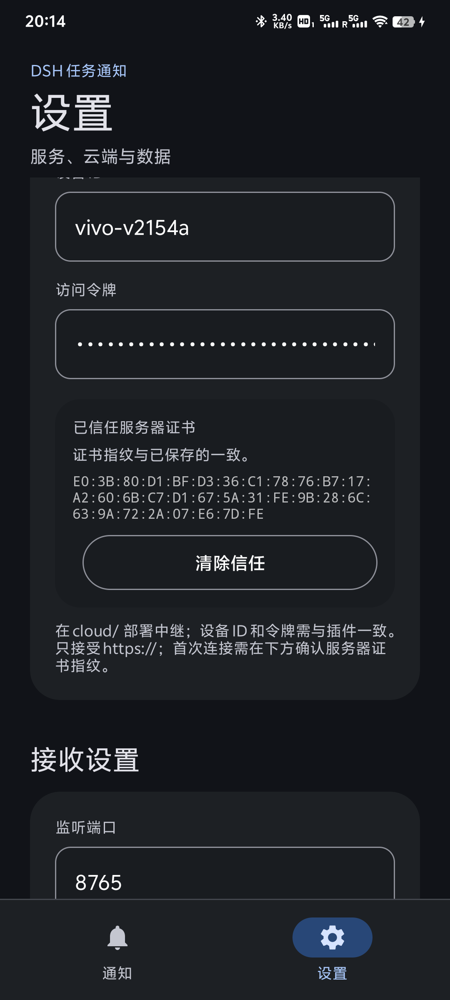

# 完整配置过程

这份文档按实际部署顺序，从一台全新 Ubuntu 24.04 云服务器开始，到手机收到局域网/云端通知为止。
示例地址为 `https://YOUR_SERVER_IP:56159`，使用 NAT 高端口和自签名证书，不需要域名、80 或 443。

> 不要把 `TOKEN`、`apk/keystore/*.p12`、`/opt/dsh-notify/tls/*key.pem` 提交到 Git 仓库。

## 0. 架构与端口

```text
DSH 插件
  ├─ 局域网：UDP 8766 发现 + HTTP 8765 POST /notify
  └─ 云端：HTTPS POST https://<服务器>:56159/api/v1/notify
                         │
                         ▼
                  云中继（Node + systemd）
                  每设备最近 200 条离线队列
                         │
                         ▼
手机 App ── HTTPS SSE /api/v1/stream ── 通知 + 本地历史
```

| 端口 | 用途 | 暴露范围 |
|---|---|---|
| 56159/TCP | 云端中继 HTTPS | 公网 → 服务器 56159 |
| <SSH_PORT>/TCP | SSH（本实例） | 仅管理端 |
| 8765/TCP | 局域网 HTTP | 仅同一 Wi-Fi |
| 8766/UDP | 局域网发现 | 仅同一 Wi-Fi |

## 1. 云服务器

### 1.1 前提

- Ubuntu 24.04 LTS，root 或可 sudo 用户
- 云厂商安全组/NAT 放行 **TCP 56159**
- 服务器能访问外网（下载 Node、安装依赖）
- 服务器时间正确（TLS 证书校验依赖时间）

本实例没有安装 Docker/Caddy：NAT 场景直接用 Node 终止 TLS，内存占用更低。

### 1.2 安装 Node.js 22

```bash
apt-get update -qq
apt-get install -y curl ca-certificates xz-utils tar openssl

cd /tmp
curl -fsSLO https://nodejs.org/dist/latest-v22.x/SHASUMS256.txt
NODE_FILE="$(awk '/linux-x64.tar.xz/ {print $2; exit}' SHASUMS256.txt)"
curl -fsSLO "https://nodejs.org/dist/latest-v22.x/${NODE_FILE}"
mkdir -p /opt
tar -xJf "${NODE_FILE}" -C /opt
ln -sfn "/opt/${NODE_FILE%.tar.xz}" /opt/node-v22
ln -sfn /opt/node-v22/bin/node /usr/local/bin/node
ln -sfn /opt/node-v22/bin/npm /usr/local/bin/npm

node --version   # v22.x
```

### 1.3 生成服务器证书

1.2.2 不再要求把 CA 内置到 APK。手机第一次连接时会展示服务器**叶子证书**的 SHA-256，
确认后固定；插件填同一个指纹即可。CA 仍然可以保留，用来签发/轮换服务器证书，或者作为
插件端的 `caFile` 校验方式。

服务器证书的 SAN 必须包含客户端实际连接使用的地址。本实例用 IP：

```bash
mkdir -p /opt/dsh-notify/tls
cd /opt/dsh-notify/tls

# CA 只用于签发服务器证书；私钥永远留在服务器
openssl genrsa -out ca-key.pem 4096
openssl req -x509 -new -nodes -key ca-key.pem -sha256 -days 3650 \
  -subj "/CN=DSH Task Notify Cloud CA" -out ca.pem

openssl genrsa -out server-key.pem 2048
openssl req -new -key server-key.pem -subj "/CN=YOUR_SERVER_IP" -out server.csr
cat > server.ext <<'EOF'
subjectAltName=IP:YOUR_SERVER_IP,DNS:YOUR_SERVER_IP.sslip.io
extendedKeyUsage=serverAuth
keyUsage=digitalSignature,keyEncipherment
EOF

openssl x509 -req -in server.csr -CA ca.pem -CAkey ca-key.pem -CAcreateserial \
  -out server.pem -days 3650 -sha256 -extfile server.ext

chmod 600 ca-key.pem server-key.pem

# 记录叶子证书指纹（手机与插件要填同一个值）
openssl x509 -in server.pem -noout -fingerprint -sha256
```

最后一行输出的 `SHA256 Fingerprint=AB:CD:...` 就是要在手机和 DSH 设置面板里核对的指纹。

如果公网 IP 改变，重新生成 `server.pem/server-key.pem`（SAN 改成新 IP），并在 App 里
重新确认新指纹。

### 1.4 安装中继文件

```bash
id -u dsh-notify >/dev/null 2>&1 || \
  useradd --system --home /opt/dsh-notify --shell /usr/sbin/nologin dsh-notify
mkdir -p /opt/dsh-notify /var/lib/dsh-notify
chown -R dsh-notify:dsh-notify /opt/dsh-notify /var/lib/dsh-notify
```

把 `cloud/server.mjs` 和 `cloud/package.json` 上传到 `/opt/dsh-notify/`，然后创建
`/etc/dsh-notify.env`（权限 600）：

```ini
TOKEN=<openssl rand -hex 32 的结果>
PORT=56159
HOST=0.0.0.0
DATA_DIR=/var/lib/dsh-notify
TLS_CERT=/opt/dsh-notify/tls/server.pem
TLS_KEY=/opt/dsh-notify/tls/server-key.pem
MAX_QUEUE=200
HEARTBEAT_MS=20000
```

```bash
chmod 600 /etc/dsh-notify.env
chown -R dsh-notify:dsh-notify /opt/dsh-notify /var/lib/dsh-notify
```

### 1.5 systemd

安装 `cloud/dsh-notify-relay.service` 到 `/etc/systemd/system/`：

```bash
systemctl daemon-reload
systemctl enable --now dsh-notify-relay
systemctl --no-pager status dsh-notify-relay
journalctl -u dsh-notify-relay -f
```

服务只监听 `0.0.0.0:56159`，由 NAT 暴露；不要再额外开放 8787。

### 1.6 验证服务器

```bash
curl --cacert /opt/dsh-notify/tls/ca.pem \
  --resolve YOUR_SERVER_IP:56159:127.0.0.1 \
  https://YOUR_SERVER_IP:56159/api/v1/health
```

应返回：

```json
{"ok":true,"app":"dsh-task-notify-relay","devices":0,"clients":0,"queued":0}
```

> Windows 自带 `curl.exe` 使用 Schannel，可能不接受 `--cacert`；用 Node/Java 或 WSL 测试更可靠。

### 1.7 NAT / 防火墙

- 云控制台：外网 TCP 56159 → 内网 TCP 56159
- 服务器本机 UFW 默认拒绝入站，必须显式放行中继端口（否则手机/电脑只会「连接超时」）：

```bash
ufw allow 56159/tcp
ufw status | grep 56159
```

- SSH <SSH_PORT> 只给自己使用
- 不要把 8787 等内部测试端口暴露到公网

> 如果健康检查在本机通过、外部却超时，先查 `ufw status` 和云厂商安全组，而不是先怀疑证书。

## 2. 插件配置

### 2.1 安装

```powershell
dsh plugin --profile desktop add .\release\dsh-plugin-task-notify-1.2.2.tgz
```

Profile 的 `package.json` 应包含：

```json
"dependencies": {
  "dsh-plugin-task-notify": "file:vendor/dsh-plugin-task-notify-1.2.2.tgz"
}
```

并确认 `dsh.profile.bundles` 包含 `dsh-plugin-task-notify`。安装后**重启 DSH**：宿主插件和
左侧栏面板都在启动时加载。

### 2.2 用左侧栏设置（推荐）

重启后左侧栏出现 **通知** 入口：

1. 云端 → 打开「启用」。
2. 服务器地址：`https://YOUR_SERVER_IP:56159`（只接受 https）。
3. 设备 ID：`vivo-v2154a`。
4. 访问令牌：`/etc/dsh-notify.env` 的 `TOKEN`。
5. 点「获取指纹」，应与服务器上 `openssl x509 -fingerprint -sha256` 的结果一致。
6. 点「使用此指纹」→「保存设置」。
7. 点「发送测试通知」，确认手机收到。

设置保存在 `%USERPROFILE%\.dsh\storages\task-notify\settings.json`，覆盖 patch 中的同名连接
参数；删除该文件可回到 patch 的值。

### 2.3 用 YAML 配置（可选）

在 profile 的 `cordis.patch.yml` 追加：

```yaml
- id: task-notify
  name: dsh-plugin-task-notify
  config:
    cloud:
      url: https://YOUR_SERVER_IP:56159
      token: <TOKEN>
      device: vivo-v2154a
      fingerprint: AB:CD:EF:...      # 64 位十六进制，可带冒号
      timeoutMs: 8000
```

如果只走云端：

```yaml
    discover: false
    devices: []
```

局域网和云端可以同时开启，任一路成功即视为送达。

### 2.4 验证日志

```text
%USERPROFILE%\.dsh\storages\task-notify\plugin.log
```

应能看到 `plugin.loaded`（含 `pinned=true`）、`cloud.ok` / `cloud.failed`、`approval.notify`。

## 3. 手机 App

### 3.1 安装

```powershell
adb install -r release\DSH-Task-Notify-1.2.2.apk
```

> 从 1.2.1 升级：1.2.2 使用新的签名密钥，先卸载旧版再安装（App 内历史与设置会清空）。

允许通知权限；vivo/iQOO 还要设置：

1. 设置 → 电池 → 后台耗电管理 → DSH 任务通知 → 允许后台高耗电
2. 设置 → 权限管理 → 自启动 → 打开开机启动/后台启动

### 3.2 云端配置

设置 → 云端中继：

- 打开「启用云端通知」
- 服务器地址：`https://YOUR_SERVER_IP:56159`
- 设备 ID：`vivo-v2154a`
- 访问令牌：服务器 `/etc/dsh-notify.env` 的 `TOKEN`
- 保存并重启服务

首次连接会显示「需要确认服务器证书」，核对 SHA-256 与服务器上的一致后点「信任并重连」。
连接成功后首页显示「云端已连接」。令牌输入框是密码类型，不会显示明文。



### 3.3 局域网（可选）

同一 Wi-Fi 下打开「接收服务」即可，无需填写电脑 IP；插件通过 UDP 8766 自动发现。
如果路由器隔离广播，在插件配置里写死手机 IP 和端口 8765。

## 4. 端到端测试

```bash
# 插件侧（需要本地 relay 或线上 relay）
node cloud/test-plugin.mjs
```

或直接在 DSH 中触发一轮任务，然后检查：

- 手机通知中心出现「任务完成」
- App「最近通知」有记录
- 云端 `/api/v1/health` 的 `clients` 为 1
- DSH 触发授权请求时出现「需要授权」和锁图标

## 5. 日常运维

```bash
systemctl restart dsh-notify-relay
journalctl -u dsh-notify-relay -n 100 --no-pager
```

- 离线队列：`/var/lib/dsh-notify/state.json`（最近 200 条/设备）
- 清空队列：停止服务，删除该文件，再启动
- 健康检查：`/api/v1/health`
- 不要把 `/var/lib/dsh-notify` 或 `/opt/dsh-notify/tls` 提交到 Git

## 6. 令牌 / 证书轮换

令牌：

```bash
# 修改 /etc/dsh-notify.env 的 TOKEN
systemctl restart dsh-notify-relay
# 在 DSH 左侧栏的「云端 → 访问令牌」和手机 App 里更新
```

证书：

```bash
# 用新 IP/域名重新生成 server.pem/server-key.pem，保留 CA 也可以
openssl x509 -in server.pem -noout -fingerprint -sha256
# 在手机 App 里出现「服务器证书已变化」→ 核对新指纹后重新信任
# 在 DSH 左侧栏点「获取指纹」→「使用此指纹」→ 保存
```

手机和插件必须使用同一个指纹；只更新一边会出现「指纹不匹配」。

## 7. 新增手机

1. 服务器不需要注册设备，第一次 POST/SSE 会自动创建。
2. App 填新的设备 ID（字母/数字/点/下划线/短横线，1–64 字符）。
3. 插件 `cloud.device`（或在左侧栏改设备 ID）改成同一个值。
4. 重启 App 服务；DSH 不需要重启。

局域网发现允许多台手机；云端按设备 ID 路由，每台手机一个队列。
