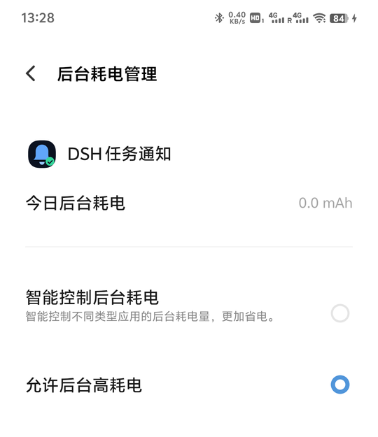

# DSH 任务通知 · 使用说明

本文覆盖：手机安装、电脑端状态、左侧栏设置面板、配对测试、配置、云端证书信任、故障排查、
更新卸载、构建与测试。从零部署服务器的完整步骤见 [完整配置过程](docs/setup.md)。

---

## 1. 交付物与版本

| 项目 | 版本 | 文件 |
|---|---|---|
| 安卓 App | 1.2.2（versionCode 5） | `release/DSH-Task-Notify-1.2.2.apk` |
| DSH 插件 | 1.2.2 | `release/dsh-plugin-task-notify-1.2.2.tgz` |

校验值：

```text
C11E64AC7D553034C52438AC93C3830F02D2E6E572E63D1763C5E69C7F7B3390  DSH-Task-Notify-1.2.2.apk
21FE128A21B076F090F94F6622D8D9130F24EF2534E4A29B1FF5C64A6347461E  dsh-plugin-task-notify-1.2.2.tgz
```

- 最低 Android 8.0（API 26），目标 API 34。
- 已用本地个人密钥签名（v2 + v3），可直接侧载，不需要上架应用商店。
- 不包含任何第三方运行时库；APK 约 260 KB。

> **签名变更提醒**：1.2.2 的签名密钥是重新生成的（仓库不含旧密钥）。Android 不允许
> 用不同签名覆盖安装，升级前请先卸载 1.2.1。App 内的历史记录与设置会一起清空，需要
> 重新填写局域网令牌和云端配置。新密钥在 `apk\keystore\dsh-task-notify.p12`，密码在
> `apk\keystore\password.txt`，两者都被 `.gitignore` 排除，请自行备份。

---

## 2. 工作原理

```text
DSH 一轮任务结束 / 弹出授权
      │  session/event: turn/end、approval/asked
      ▼
dsh-plugin-task-notify（宿主）
      │  1. 过滤：只处理根会话、指定状态、最短时长、冷却
      │  2. LAN：UDP 8766 广播发现 → HTTP POST 手机:8765/notify
      │  3. 云端：HTTPS POST 中继 /api/v1/notify（证书指纹或 CA 校验）
      ▼
安卓 App 校验 → 高优先级通知 → 本地历史
```

- 电脑端只依赖 Node 内置模块（`dgram`、`http`、`https`、`tls`、`fs`、`os`）。
- 手机端是原生 Java + Android Framework，没有 AndroidX、Gradle 或第三方 SDK。
- 浏览器端设置面板是 `plugin/lib/client.js`，由 DSH 的客户端模块加载器直接执行，
  不需要打包步骤；它只访问本机回环地址上的 `/dsh-task-notify/*` 接口。

---

## 3. 手机安装

1. 把 `DSH-Task-Notify-1.2.2.apk` 传到手机（USB、微信文件传输助手、网盘均可）。
2. 点开 APK，按系统提示允许「安装未知来源应用」。
3. 安装后打开 **DSH 任务通知**。
4. 首次启动会请求通知权限，选择 **允许**。
5. 首页应显示绿色的「通知服务运行中」，以及类似 `192.168.1.23:8765` 的地址。
6. 点 **发送测试**，应立即收到一条本地测试通知（不需要电脑）。
7. 建议点 **电池优化**，允许后台运行。
8. **vivo / iQOO 必做**：按 3.1 额外开启「允许后台高耗电」，否则锁屏后会被系统冻结。

> 从 1.2.1 升级：先卸载旧版再安装 1.2.2（签名不同，无法覆盖安装）。
> App 首次打开后会启动前台服务；之后可以退到后台，但不要强行停止 App。
> 手机重启后，如果之前在 App 里保持服务开启，`BootReceiver` 会尝试自动拉起。

### 3.1 vivo / iQOO 必做（本机实测）

只做 Android 标准的「忽略电池优化」不够：vivo 仍会在锁屏后把 App 冻结，前台服务通知
还在，但 HTTP 端口不再响应。

1. 打开 **设置 → 电池 → 后台耗电管理**。
2. 找到 **DSH 任务通知**。
3. 选择 **允许后台高耗电**（不要选「智能控制后台耗电」）。
4. 再打开 **设置 → 权限管理 → 自启动**，搜索 `DSH`，打开 **开机启动 / 后台启动**。



实测对照：

| 设置 | 锁屏 30 秒后从电脑请求 `/ping` | 进程状态 |
|---|---|---|
| 仅标准电池优化 | 超时（约 5 秒无响应） | `isFrozen=true`，WakeLock 显示 `DISABLED` |
| 允许后台高耗电 | 150–170ms 正常返回 | 未冻结，服务持续监听 |

如果找不到上述路径，可以在系统设置搜索「后台耗电」或「自启动」；不同 OriginOS 版本的
菜单位置可能略有差异。

### 3.2 手机端功能

- **通知页**：运行状态卡（是否运行、监听地址、设备名/端口/版本、最近投递）和最近通知列表。
- **接收服务开关**（设置 → 服务）：停止后不再接收任何通知，重启手机也不会自动启动。
- **发送测试通知**（设置 → 服务）：只发本地通知，用来确认通知权限、声音、锁屏显示正常。
- **电池优化 / 后台运行设置**（设置 → 服务）：打开系统白名单；vivo / iQOO 还需要按 3.1
  单独开启「允许后台高耗电」。
- **接收设置**（设置 → 接收设置）：端口、设备名称（显示在电脑端）、可选访问令牌。
- **最近通知**（通知页）：最近 50 条，点按查看全文。
- **清空记录**（设置 → 数据）：只清手机本地历史，不影响电脑端。

> 修改端口/令牌后点「保存并重启服务」。端口范围 1024–65535，默认 8765。

### 3.3 界面与云端

- **底部导航**：两个页面，「通知」和「设置」。
- **通知页**：只展示运行状态卡（局域网地址、云端连接状态、最近投递）和最近通知。
- **设置页**：接收服务、发送测试、电池优化、后台运行、云端中继、端口/设备名/令牌、
  保存、清空记录、关于。
- **应用图标**：使用 DSH 桌面端的鲸鱼图标；通知栏小图标为白色鲸鱼剪影。
- 点按通知会打开「通知」页并自动滚动到「最近通知」。

App 设置 → 云端中继：

1. 打开「启用云端通知」。
2. 服务器地址填 `https://服务器地址:端口`（**只接受 https**）。
3. 设备 ID 填 `vivo-v2154a`（与 DSH 设置面板一致）。
4. 令牌从服务器 `/etc/dsh-notify.env` 的 `TOKEN` 读取（不要发到公开群聊）。
5. 点「保存并重启服务」。首次连接会显示服务器证书指纹，核对后点「信任并重连」。
6. 首页显示「云端已连接」即成功。

服务器运维、证书、令牌轮换和新增手机见 [cloud/README.md](cloud/README.md)。

---

## 4. 电脑端状态与左侧栏设置

插件安装进 DSH 的 `desktop` profile 后：

```text
%USERPROFILE%\.dsh\profiles\desktop\
├─ package.json
│    dependencies: "dsh-plugin-task-notify": "file:vendor/dsh-plugin-task-notify-1.2.2.tgz"
│    dsh.profile.bundles: [..., "dsh-plugin-task-notify"]
└─ node_modules\dsh-plugin-task-notify\
```

### 4.1 左侧栏「通知」面板

重启 DSH 后，左侧栏会出现 **通知** 入口（图标为铃铛）。面板包含：

| 区域 | 内容 |
|---|---|
| 运行状态 | 已发现手机、云端状态、最近一次投递、检查连接、发送测试通知 |
| 局域网 | 访问令牌（可显示/生成）、手动配置的设备列表 |
| 云端中继 | 启用开关、服务器地址、设备 ID、访问令牌、证书 SHA-256、CA 文件（进阶） |

- 保存后立即生效，不需要重启 DSH；下一次通知就会使用新配置。
- 设置写入 `%USERPROFILE%\.dsh\storages\task-notify\settings.json`（仅本机可写）。
- 面板接口只接受来自 **127.0.0.1 / ::1** 的请求；通过局域网访问 DSH Web 时，面板仍能显示，
  但保存会被拒绝（返回 403）。

### 4.2 配置优先级

1. `settings.json`（左侧栏保存的值）优先。
2. 没有保存过时，使用 profile 的 `cordis.patch.yml`。
3. 删除 `settings.json` 即可回到 patch 的值。

`notifyOn`、`minDurationMs`、`cooldownMs` 等通知规则仍然只在 `cordis.patch.yml` 里配置，
左侧栏只负责两台设备之间需要经常改动的连接参数。

### 4.3 查看日志

```text
%USERPROFILE%\.dsh\storages\task-notify\plugin.log
```

JSON 行日志，包含 `plugin.loaded`、`turn.notify`、`deliver.ok`、`cloud.ok`、`approval.notify`
等事件；超过 1 MB 会在启动时轮转为 `plugin.log.1`。

---

## 5. 配对与测试

### 5.1 自动发现（默认）

插件在发送前（首次或缓存超过 10 分钟）向 UDP 8766 广播发现包，手机应答自己的名称、端口
和型号，电脑直接向该地址 POST 通知。手机 IP 显示在 App 首页。

### 5.2 用 `phone_notify` 工具测试

对助手说：

> 用 phone_notify 测试一下手机通知

工具返回每台设备的 `name`、`host`、`port`、`online` 和错误原因。也可以在左侧栏面板点
「发送测试通知」或「检查连接」。

### 5.3 手动指定手机

自动发现失败时，在 profile 的 `cordis.patch.yml` 写死地址：

```yaml
- id: task-notify
  config:
    discover: false
    devices:
      - host: 192.168.1.23
        port: 8765
        name: 我的手机
```

---

## 6. 配置

`cordis.patch.yml` 里所有字段都可选。常用字段：

```yaml
- id: task-notify
  name: dsh-plugin-task-notify
  config:
    discover: true
    notifyOn: [completed, error]
    minDurationMs: 15000
    cooldownMs: 2500
    includePreview: true
    token: ""
    devices: []
    cloud:
      url: https://<SERVER>:<PORT>
      token: <TOKEN>
      device: vivo-v2154a
      fingerprint: <64 位十六进制 SHA-256>
      caFile: C:/path/to/ca.pem    # 与 fingerprint 二选一即可
```

完整字段、通知规则和工具说明见 [插件配置参考](plugin/README.zh.md)。

---

## 7. 云端证书信任（1.2.2 的新模型）

旧版本把一张 CA 公钥硬编码进 APK，用户必须自己重签 APK 才能用自己的服务器。1.2.2 改成
**按证书指纹信任**：

1. 手机首次连接中继时，App 会展示服务器叶子证书的 SHA-256（冒号分隔的十六进制），
   并拒绝建立连接。
2. 你在 DSH 左侧栏点「获取指纹」，把显示的 SHA-256 与手机上的对比，确认一致。
3. 在手机上点「信任并重连」，指纹存进 App；此后只接受这张证书。
4. 插件侧填同一个指纹（或 CA 文件），每次投递前校验；不匹配会直接失败并提示
   「云端证书指纹不匹配」。

要点：

- 服务器换证书后，手机和插件都要重新确认一次指纹。
- 使用公有 CA（例如 Let's Encrypt）时，可以不填指纹：App 用系统信任库校验，插件用系统
  根证书校验。填了指纹则以指纹为准。
- 证书的 SAN 必须包含你实际连接的地址（IP 或域名）；否则 TLS 主机名校验会失败。
- 指纹是叶子证书的 SHA-256，不是 CA 的指纹。

---

## 8. 故障排查

| 现象 | 处理 |
|---|---|
| 左侧栏没有「通知」入口 | 1.2.2 之前的插件没有浏览器端；确认已安装 1.2.2 并**重启 DSH**；确认 profile 的 bundles 含 `dsh-plugin-task-notify` |
| 面板显示「无法读取插件状态」 | 宿主接口未注册（没有 webServer）或插件加载失败；看 `plugin.log` |
| 保存提示 403 | 正在用局域网地址访问 DSH；请在电脑本机的 `127.0.0.1` 页面操作 |
| `phone_notify discover` 找不到设备 | 确认手机 App 正在运行、与电脑同一 Wi-Fi；关闭路由器的 AP 隔离/访客网络；允许 `DeepSeek Harness` 在 Windows 防火墙的专用网络访问 |
| 能找到设备但发送失败 | 手机端「服务运行中」是否为绿色；端口是否被占用；两边令牌是否一致 |
| 锁屏收不到 | 关闭电池优化（App 首页「电池优化」）；vivo/iQOO 按 3.1 设置；检查通知渠道是否被静音 |
| 云端「证书未信任」 | 按第 7 节在手机上确认指纹；确认服务器地址与证书 SAN 一致 |
| 云端「指纹不匹配」 | 服务器换了证书或中间人；核对后重新信任，插件同步更新指纹 |
| 云端「TLS 证书校验失败」 | 自签名证书没填指纹/CA；填指纹或 `caFile` |
| 云端一直「连接超时」 | 服务器防火墙没放行 56159：`ufw allow 56159/tcp`，并检查云安全组与 `iptables -S ufw-user-input` |
| 短回复不通知 | `minDurationMs` 默认为 15 秒且只过滤「无工具调用」的完成回合；改成 0 可全部通知 |
| Windows 防火墙提示 | 允许访问「专用网络」；UDP 8766 只用于自动发现，失败时可在面板或 patch 里写死手机 IP |

诊断命令：

```powershell
# 看插件日志
Get-Content "$env:USERPROFILE\.dsh\storages\task-notify\plugin.log" -Tail 20

# 看最近一次投递
Get-Content "$env:USERPROFILE\.dsh\storages\task-notify\last-delivery.json"

# 从电脑直接测试手机 HTTP（把 IP 换成 App 首页地址）
curl.exe http://192.168.1.23:8765/ping
```

---

## 9. 安全与隐私

- 局域网默认不校验令牌：同一网段内任何设备都能向 8765 端口投递通知。需要隔离时在
  App 和左侧栏面板填同一个非空令牌。
- 云端只接受 `https://`（本机回环地址例外）；App 的 `usesCleartextTraffic` 已关闭。
- 手机只信任首次确认过的证书指纹；插件每次投递前校验同一指纹或 CA。
- 设置面板的读写接口只允许本机回环地址访问，令牌不会发到网络。
- 通知正文可能包含工作内容；`includePreview: false` 只发送标题与用时，不留正文预览。
- 手机端只监听本地网络，不提供文件读写、远程控制或回传通道。

---

## 10. 更新与卸载

### 更新插件

1. 把新的 tgz 放进 profile 的 `vendor/`（或任意路径），更新 `package.json` 的 dependency。
2. 执行安装（或把解压后的目录放进 `node_modules`）。
3. 重启 DSH。左侧栏面板的设置在 `settings.json` 里，会保留。

### 更新 App

1. 签名不变时：`adb install -r release\DSH-Task-Notify-1.2.2.apk`。
2. 签名变化时：先卸载旧版，再安装（设置与历史会清空）。

### 卸载

1. 在 DSH 的插件页面移除 `dsh-plugin-task-notify`，或从 profile 的 `dependencies` /
   `dsh.profile.bundles` 中删除后重新安装依赖。
2. 手机上卸载「DSH 任务通知」。
3. 可选删除 `%USERPROFILE%\.dsh\storages\task-notify\`（日志、设备缓存、settings.json）。

---

## 11. 构建与测试

### 11.1 构建 APK

前置：

- JDK 17+（脚本用 `javac -encoding UTF-8`，避免中文 Windows 的 GBK 默认编码踩坑）
- Node.js 22+
- Android build-tools 34 + platform android-34，放在 `_sdk\` 下

SDK 下载地址（Google 官方）：

```text
https://dl.google.com/android/repository/build-tools_r34-windows.zip
https://dl.google.com/android/repository/platform-34-ext7_r03.zip
```

解压后应得到：

```text
_sdk\build-tools\android-14\aapt2.exe
_sdk\build-tools\android-14\d8.bat
_sdk\build-tools\android-14\zipalign.exe
_sdk\build-tools\android-14\apksigner.bat
_sdk\platform\android-34\android.jar
```

构建：

```powershell
$env:DSH_KEYSTORE_PASSWORD = "your-keystore-password"
.\build-apk.cmd
```

产物：`release\DSH-Task-Notify-1.2.2.apk`。

脚本做的事：

1. `aapt2 compile` 资源 → `aapt2 link` 生成资源 APK 和 `R.java`。
2. `javac --release 8 -encoding UTF-8` 编译 Java。
3. 用 `_tools\strip-method-parameters.mjs` 去掉 javac 生成的 `MethodParameters`
   调试属性（d8 34 在该属性参数名为空时会内部 NPE）。
4. `jar` + `d8 --min-api 26` 生成 `classes.dex`。
5. `jar` 把 dex 写回 APK，`zipalign -f 4` 对齐。
6. 首次构建自动生成 `apk\keystore\dsh-task-notify.p12`。
7. `apksigner sign`（v2 + v3）并用 `apksigner verify` 自检。

> 项目路径含中文时，Windows PowerShell 5.1 把**绝对路径**传给原生 Android 工具会乱码；
> 脚本全部使用相对路径。请从项目根目录运行，或用 `build-apk.cmd`。

### 11.2 测试

接收核心（HTTP / JSON / UDP / 令牌 / 证书固定）在桌面 JVM 上运行：

```powershell
javac --release 11 -encoding UTF-8 -d apk\build\jvm-classes `
  apk\src\com\dsh\tasknotify\Json.java `
  apk\src\com\dsh\tasknotify\NotifyPayload.java `
  apk\src\com\dsh\tasknotify\NotifySink.java `
  apk\src\com\dsh\tasknotify\NotifyHttpServer.java `
  apk\src\com\dsh\tasknotify\DiscoveryServer.java `
  apk\src\com\dsh\tasknotify\CloudTrust.java

javac --release 11 -encoding UTF-8 -cp apk\build\jvm-classes -d apk\build\test-classes `
  apk\test\com\dsh\tasknotify\ServerTest.java `
  apk\test\com\dsh\tasknotify\RunServer.java `
  apk\test\com\dsh\tasknotify\CloudTrustTest.java

java -cp "apk\build\jvm-classes;apk\build\test-classes" com.dsh.tasknotify.ServerTest
# RESULT passed=19 failed=0

java -cp "apk\build\jvm-classes;apk\build\test-classes" com.dsh.tasknotify.CloudTrustTest
# RESULT passed=8 failed=0
```

插件集成测试（需要先启动 RunServer 作为真实接收端）：

```powershell
# 终端 A
java -cp "apk\build\jvm-classes;apk\build\test-classes" `
  com.dsh.tasknotify.RunServer 18765 18766 _tmp\server-ready.txt _tmp\notifications.jsonl

# 终端 B
node apk\test\plugin-integration.mjs
# ALL PLUGIN TESTS PASSED
```

设置面板 API（纯 Node，不需要 JVM）：

```powershell
node plugin\test\settings-api.mjs
# SETTINGS API TESTS PASSED
```

云端中继（先启动本地 relay）：

```powershell
$env:TOKEN="test-token-123"; $env:PORT="8787"; node cloud\server.mjs
node cloud\test-relay.mjs
node cloud\test-plugin.mjs
```

### 11.3 真机实测与未验证

**真机已验证（vivo V2154A，Android 14 / API 34）**：

- 通过 ADB 安装 APK，App 前台服务启动，`GET /ping` 返回 200。
- 运行中的 DSH 插件真实发现 `V2154A@192.168.31.26:8765`，`phone_notify test` 投递成功。
- 通知在通知中心显示正常，点按通知能打开「通知」页并自动定位到历史记录。
- 云端链路：插件 → HTTPS 中继 → 手机 SSE → 通知/历史。
- 授权通知：`approval/asked` → 「需要授权」通知 → 历史记录锁图标。
- 双通道去重：同一 `payload.id` 同时走局域网和云端时，10 分钟窗口内只保留一条通知/历史。

**1.2.2 新增并在本机验证**：

- 证书指纹固定：`CloudTrustTest` 8 项（未信任拒绝、指纹匹配放行、指纹变化拒绝、格式解析）。
- 插件指纹校验：自签名中继 + 正确指纹可送达；错误指纹在发送令牌前被拒绝。
- 明文 HTTP：远程 `http://` 云端地址被插件和 App 同时拒绝。
- 左侧栏设置面板：本机保存、读取、测试通知、非回环 403（`plugin/test/settings-api.mjs`）。
- 真机（vivo V2154A / Android 14）重装 1.2.2 并实测：
  - 首次连接云端显示「需要确认服务器证书」+ SHA-256，确认后「云端已连接」；
  - 插件经指纹校验投递，手机 SSE 收到并显示通知（relay `clients=1`）；
  - App 首页显示 `v1.2.2`、`云端已连接 · <服务器>`，历史里有测试通知。
  - 期间发现并修复：服务器 UFW 未放行 56159 时手机只会「连接超时」，见 [完整配置过程](docs/setup.md#17-nat--防火墙)。

**仍未验证**：

- 只在 vivo V2154A / Android 14 上实测；Android 8–13、16 与其他厂商 ROM 未逐一验证。
- 未验证长时间（数小时/数天）锁屏、深度 Doze、跨路由器/VLAN、IPv6-only、企业网络。
- 服务常驻通知里的 IP 在切换 Wi-Fi 后可能滞后；以 App 首页地址和实际 `/ping` 为准。

---

## 12. 已知限制

- **局域网要求同网段**：手机与电脑必须能互相直连；跨网段请用云端中继。
- **vivo / iQOO 额外设置**：必须允许「后台高耗电」，否则锁屏后进程会被冻结。
- **无 DSH 图形设置页**：通知规则仍在 `cordis.patch.yml`；左侧栏只管理连接参数。
- **通知内容**：默认只发送标题与最后一段文本，不发送完整会话；`includePreview` 可关闭。
- **单用户密钥**：APK 用本地个人密钥签名，适合自用/内部分发，不适合上架。
- **端口**：手机端默认 8765，UDP 发现 8766；发现端口固定 8766。
- **证书轮换**：换服务器证书后，手机与插件都要重新确认指纹。
- **服务通知地址可能滞后**：切换 Wi-Fi 后常驻通知里的 IP 不一定立即刷新，以 App 首页为准。
- **重启自启有延迟**：部分 ROM 会延迟 1–2 分钟才拉起服务；打开一次 App 可立即恢复。
- **Android 16 本地网络权限**：目标 API 34，暂不受新本地网络权限模型影响；未来升级 target 需重新验证。

---

## 13. 文件结构

```text
dsh-plugin-task-notify/
├─ README.md
├─ 使用说明.md
├─ build-apk.ps1 / build-apk.cmd
├─ release/
│  ├─ DSH-Task-Notify-1.2.2.apk
│  ├─ dsh-plugin-task-notify-1.2.2.tgz
│  └─ SHA256SUMS.txt
├─ plugin/
│  ├─ lib/index.js          宿主：通知、发现、云端投递、本机设置接口
│  ├─ lib/client.js         浏览器：左侧栏「通知」面板
│  ├─ test/settings-api.mjs 设置接口测试
│  ├─ cordis.patch.yml
│  ├─ package.json
│  └─ README.md / README.zh.md
├─ apk/
│  ├─ src/com/dsh/tasknotify/*.java
│  ├─ res/
│  ├─ test/com/dsh/tasknotify/{ServerTest,CloudTrustTest,RunServer}.java
│  └─ README.md
├─ cloud/
│  ├─ server.mjs
│  ├─ test-relay.mjs / test-plugin.mjs
│  └─ README.md
└─ docs/
   ├─ setup.md
   ├─ protocol.md
   └─ device-test-report.md
```
