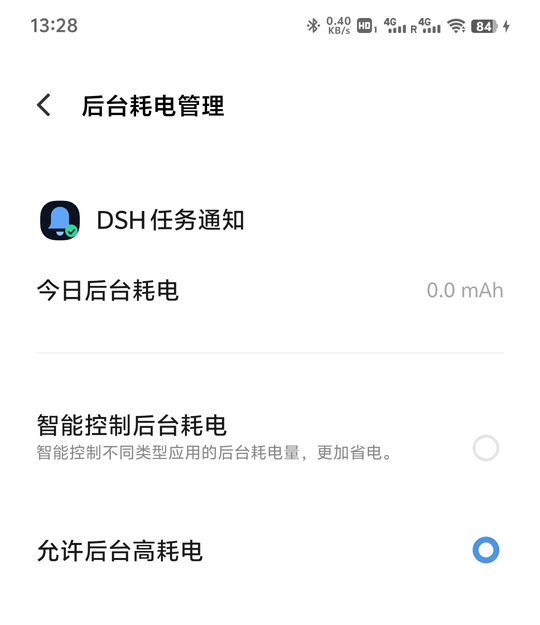

# DSH 任务通知 · 使用说明

本文覆盖：手机安装、电脑端状态、配对测试、配置、故障排查、更新卸载、构建与测试。
从零部署服务器、CA、令牌、插件和 App 的完整步骤见 [完整配置过程](docs/setup.md)。

---

## 1. 交付物与版本

| 项目 | 版本 | 文件 |
|---|---|---|
| 安卓 App | 1.2.1 | `release/DSH-Task-Notify-1.2.1.apk` |
| DSH 插件 | 0.2.0 | `release/dsh-plugin-task-notify-0.2.0.tgz` |

APK 校验值：

```text
98EE58EC27EF91AB14614610C5B01F05586C68CD78E2C375D34397D41FBB1859  DSH-Task-Notify-1.2.1.apk
```

- 最低 Android 8.0（API 26），目标 API 34。
- 已用本地个人密钥签名（v2 + v3），可直接侧载，不需要上架应用商店。
- 不包含任何第三方运行时库；APK 约 260 KB（含应用图标和多密度位图）。

---

## 2. 工作原理

```text
DSH 一轮任务结束
      │  session/event: turn/end（reason.kind）
      ▼
dsh-plugin-task-notify
      │  1. 过滤：只处理根会话、指定状态、最短时长、冷却
      │  2. UDP 8766 广播 {"t":"dsh.discover","v":1}
      ▼
手机 App 的 DiscoveryServer 应答 {"t":"dsh.device","name":...,"port":8765}
      │
      ▼
插件 HTTP POST http://手机IP:8765/notify（JSON 通知）
      │
      ▼
手机 NotifyHttpServer 校验 → NotificationManager 发高优先级通知
      │
      └─ 写入手机本地历史（最多 50 条），App 首页可查看
```

- 电脑端只依赖 Node 内置模块（`dgram`、`http`、`fs`、`os`）。
- 手机端是原生 Java + Android Framework，没有 AndroidX、Gradle 或第三方 SDK。
- 默认走局域网；启用云端后也可经你的 HTTPS 服务器转发，不经过第三方云。

---

## 3. 手机安装

1. 把 `DSH-Task-Notify-1.2.1.apk` 传到手机（USB、微信文件传输助手、网盘均可）。
2. 点开 APK，按系统提示允许「安装未知来源应用」。
3. 安装后打开 **DSH 任务通知**。
4. 首次启动会请求通知权限，选择 **允许**。
5. 首页应显示绿色的「通知服务运行中」，以及类似 `192.168.1.23:8765` 的地址。
6. 点 **发送测试**，应立即收到一条本地测试通知（不需要电脑）。
7. 建议点 **电池优化**，允许后台运行。
8. **vivo / iQOO 必做**：按 3.1 额外开启「允许后台高耗电」，否则锁屏后会被系统冻结。

> App 首次打开后会启动前台服务；之后可以退到后台，但不要强行停止 App。
> 手机重启后，如果之前在 App 里保持服务开启，`BootReceiver` 会尝试自动拉起。

### 3.1 vivo / iQOO 必做（本机实测）

这是本次真机测试发现的关键项。只做 Android 标准的「忽略电池优化」不够：vivo 仍会在
锁屏后把 App 冻结，前台服务通知还在，但 HTTP 端口不再响应。

1. 打开 **设置 → 电池 → 后台耗电管理**。
2. 找到 **DSH 任务通知**。
3. 选择 **允许后台高耗电**（不要选「智能控制后台耗电」）。
4. 再打开 **设置 → 权限管理 → 自启动**，搜索 `DSH`，打开 **开机启动 / 后台启动**。



实测对照：

| 设置 | 锁屏 30 秒后从电脑请求 `/ping` | 进程状态 |
|---|---|---|
| 仅标准电池优化 | 超时（约 5 秒无响应） | `isFrozen=true`，WakeLock 显示 `DISABLED` |
| 允许后台高耗电 | 150–170ms 正常返回 | 未冻结，服务持续监听 |

如果找不到上述路径，可以在系统设置搜索「后台耗电」或「自启动」；不同 OriginOS 版本的
菜单位置可能略有差异。

### 3.2 手机端功能

- **通知页**：运行状态卡（是否运行、监听地址、设备名/端口/版本、最近投递）和最近通知列表。
- **接收服务开关**（设置 → 服务）：停止后不再接收任何通知，重启手机也不会自动启动。
- **发送测试通知**（设置 → 服务）：只发本地通知，用来确认通知权限、声音、锁屏显示正常。
- **电池优化 / 后台运行设置**（设置 → 服务）：打开系统白名单；vivo / iQOO 还需要按 3.1
  单独开启「允许后台高耗电」。
- **接收设置**（设置 → 接收设置）：端口、设备名称（显示在电脑端）、可选访问令牌。
- **最近通知**（通知页）：最近 50 条，点按查看全文。
- **清空记录**（设置 → 数据）：只清手机本地历史，不影响电脑端。

> 修改端口/令牌后点「保存并重启服务」。端口范围 1024–65535，默认 8765。

---

### 3.3 界面与云端

- **底部导航**：两个页面，「通知」和「设置」。
- **通知页**：只展示运行状态卡（局域网地址、云端连接状态、最近投递）和最近通知。
- **设置页**：接收服务、发送测试、电池优化、后台运行、云端中继、端口/设备名/令牌、
  保存、清空记录、关于。
- **应用图标**：使用 DSH 桌面端的鲸鱼图标；通知栏小图标为白色鲸鱼剪影。
- 点按通知会打开「通知」页并自动滚动到「最近通知」。

云端中继已经部署在：

```text
https://YOUR_SERVER_IP:56159
```

App 设置 → 云端中继：

1. 打开「启用云端通知」。
2. 服务器地址填 `https://YOUR_SERVER_IP:56159`。
3. 设备 ID 填 `vivo-v2154a`。
4. 令牌从服务器 `/etc/dsh-notify.env` 的 `TOKEN` 读取（不要发到公开群聊）。
5. 点「保存并重启服务」，首页显示「云端已连接」即成功。

服务器运维、证书、令牌轮换和新增手机见 [cloud/README.md](cloud/README.md)。

---

## 4. 电脑端状态

插件已经安装进 DSH 的 `desktop` profile：

```text
%USERPROFILE%\.dsh\profiles\desktop\
├─ package.json
│    dependencies: "dsh-plugin-task-notify": "file:vendor/dsh-plugin-task-notify-0.2.0.tgz"
│    dsh.profile.bundles: [..., "dsh-plugin-task-notify"]
├─ vendor\dsh-plugin-task-notify-0.2.0.tgz
└─ node_modules\dsh-plugin-task-notify\
```

插件加载时会写诊断日志：

```text
%USERPROFILE%\.dsh\storages\task-notify\plugin.log
```

最后一次投递结果：

```text
%USERPROFILE%\.dsh\storages\task-notify\last-delivery.json
```

发现的手机缓存：

```text
%USERPROFILE%\.dsh\storages\task-notify\devices.json
```

### 关于当前运行中的版本

安装过程中 DSH 热加载了旧版插件；磁盘上的最终版本是 **0.2.0**。重启一次 DSH 后会加载
0.2.0 增加云端中继和 `approval/asked` 授权通知，并修复 `phone_notify` 输出校验。

如果 `phone_notify` 返回：

```text
tool "phone_notify" returned invalid output: missing required property "value.devices[0].online"
```

说明当前进程还是 0.1.0，重启 DSH 即可。自动通知不受影响。

---

## 5. 配对与测试

### 5.1 自动发现（默认）

插件在发送前向 UDP 8766 广播发现包，手机 App 回复自己的名称、端口和型号。通常不需要
在电脑上填写手机 IP。

要求：

- 电脑和手机在同一个 Wi-Fi / 局域网，并且 **IP 前三段一致**（例如电脑 `192.168.1.100`、
  手机 `192.168.1.23`）。
- 路由器没有开启 AP 隔离（访客网络通常开启）。
- 手机 App 的通知服务正在运行。

> **双频路由器的坑（本机实测）**：重启后手机自动连到了另一个 SSID
> `huawei-super-wifi-5G`（`192.168.1.24`），而电脑在 `Miwifi`（`192.168.1.100`），
> 两个网段互不相通，发现和投递都会失败。后来把手机连回 `Miwifi`（`192.168.1.23`）
> 才恢复。请确认手机和电脑连的是同一个 SSID；必要时关闭系统的「网络助理 / 自动切换网络」。

### 5.2 用 `phone_notify` 工具测试

插件注册了一个诊断工具，可以直接对助手说：

> 用 phone_notify 测试一下手机通知。

或分别使用：

| action | 作用 |
|---|---|
| `discover` | 广播发现并 ping 手机，返回每台设备是否在线 |
| `test` | 发送一条固定测试通知 |
| `send` | 发送自定义 `title` / `body` |

工具返回示例：

```text
已送达 1/1 台设备：Xiaomi 14 192.168.1.23:8765
```

失败时会返回每台设备的具体原因（连接拒绝、超时、令牌不匹配等）。

### 5.3 手动指定手机

自动发现失败时，在 DSH profile 的 `cordis.patch.yml` 追加：

```yaml
- id: task-notify
  config:
    discover: false
    devices:
      - host: 192.168.1.23
        port: 8765
        name: 我的手机
```

手机 IP 显示在 App 首页。保存后 HMR 会尝试重载配置；如果没有生效，重启 DSH。

---

## 6. 配置

完整字段见 [plugin/README.zh.md](plugin/README.zh.md)。常用项：

```yaml
- id: task-notify
  config:
    notifyOn: [completed, error]   # 还支持 aborted/blocked/max-tokens/interrupted/forked
    minDurationMs: 15000           # 纯聊天短回合不打扰；有工具调用的回合不受限
    cooldownMs: 2500               # 同一会话两次通知的最小间隔
    includePreview: true           # 是否把最后一条助手回复放入正文
    previewChars: 140
    discover: true
    discoveryPort: 8766
    port: 8765
    timeoutMs: 3500
    attempts: 2
    token: ""                      # 可选，与手机 App 一致
    ignoreSubagents: true
    tool: true
    logToFile: true
    notifyOnStart: false
```

### 通知规则（默认）

- 只处理 **根会话** 的回合结束；子代理回合默认忽略，避免通知轰炸。
- 默认只推 `completed` 和 `error`；取消、阻塞、超长等状态需显式加入 `notifyOn`。
- 完成回合如果**没有工具调用**且时长小于 15 秒，视为普通闲聊，不通知。
- 有工具调用的完成回合、或错误回合，不受最短时长限制。
- 同一会话 2.5 秒内不会重复通知。
- 通知标题为 `headline + 会话标题`，正文为最后一条助手文本（或错误信息）。
- 展开通知会显示用时、工具调用次数、项目名、模型。

---

## 7. 故障排查

| 现象 | 原因与处理 |
|---|---|
| `discover` 找不到手机 | 确认 App 在运行且显示绿色；同一 Wi-Fi；关闭路由器 AP 隔离/访客网络；关闭电脑 VPN 或让 VPN 放行局域网；允许 `DeepSeek Harness` 在 Windows 防火墙的「专用网络」访问；手机换端口后重试 |
| 能找到设备但发送失败 | 手机端服务是否被系统停止；端口是否被其他 App 占用；App 与插件令牌是否一致；查看 `last-delivery.json` 的 `error` |
| 锁屏后收不到，`/ping` 超时 | **vivo / iQOO 重点**：标准电池优化不够，必须按 3.1 选择「允许后台高耗电」。实测未设置时进程被冻结、WakeLock 显示 `DISABLED`，设置后锁屏 30 秒仍正常响应。其他 ROM 检查自启动、后台活动、电池白名单 |
| 重启后手机换到别的 Wi-Fi | 双频路由器的 2.4G/5G 可能是不同 SSID/网段；把手机连回电脑所在的 SSID（本机是 `Miwifi` → `192.168.1.x`），并关闭「网络助理 / 自动切换网络」 |
| 服务显示运行但电脑连不上 | 检查手机 IP 与电脑 IP 前三段是否一致；App 首页显示的是当前 IP，服务常驻通知里的地址可能滞后；用 `curl http://手机IP:8765/ping` 验证 |
| 重启后要等 1–2 分钟才收到 | vivo 等 ROM 的 BOOT_COMPLETED 启动会延迟；打开一次 App 可立即恢复。确认「自启动 → 开机启动/后台启动」已开 |
| 通知没有声音 | 系统设置里「DSH 任务通知 → 任务通知」渠道是否关闭了声音；勿扰模式；媒体/通知音量 |
| 短回复不通知 | 默认 `minDurationMs: 15000` 且只过滤无工具调用的完成回合；改成 `0` 可全部通知 |
| 通知正文为空 | 最后一条助手消息没有文本（只有工具调用/图片）；可设置 `includePreview: false`，正文会显示用时 |
| Windows 防火墙弹窗 | 勾选「专用网络」；UDP 8766 只用于发现，失败时手动填手机 IP 即可绕过 |
| 手机 IP 变了 | 自动发现会更新缓存；如果仍需手动配置，改成新 IP |
| App 首页地址是 `0.0.0.0` / 空白 | 手机没有连 Wi-Fi；连接后重新打开 App 或重启服务 |
| 端口 8765 被占用 | 在 App 改端口（如 18765）并保存；插件会自动读取发现应答里的端口，无需改电脑配置；手动设备需同步改 `port` |
| 手机重启后没自动运行 | 部分系统限制 BOOT_COMPLETED 启动前台服务；打开一次 App 即可 |
| 电脑端插件日志没有 `plugin.loaded` | 插件未成功加载；检查 `plugin.log`、DSH profile 的 bundles、依赖是否安装 |

### 诊断命令

```powershell
# 看插件日志
Get-Content "$env:USERPROFILE\.dsh\storages\task-notify\plugin.log" -Tail 50

# 看最近一次投递
Get-Content "$env:USERPROFILE\.dsh\storages\task-notify\last-delivery.json"

# 从电脑直接测试手机 HTTP（把 IP 换成 App 首页地址）
curl.exe http://192.168.1.23:8765/ping
```

---

## 8. 安全与隐私

- 没有第三方推送、账号或遥测；局域网直连或经你自己的云服务器转发。
- 手机端只监听通知端口，不提供文件读写、远程控制、命令执行或回传通道。
- 默认不校验令牌：同一 Wi-Fi 内任何设备都能向 8765 端口 POST 通知。需要更强隔离时，
  在 App「访问令牌」和插件 `token` 中设置同一个值；之后所有 `/ping`、`/notify` 都需要
  `Authorization: Bearer <token>`。
- 通知正文可能包含工作内容。`includePreview: false` 只发送标题、用时和状态。
- 手机历史保存在 App 私有 SharedPreferences 中，卸载 App 即清除。
- 电脑端诊断日志只记录状态、设备地址和投递结果，不记录通知正文。

---

## 9. 更新插件

```powershell
$profile = "$env:USERPROFILE\.dsh\profiles\desktop"
# 1. 把新的 tgz 放进 profile 的 vendor 目录
Copy-Item ".\release\dsh-plugin-task-notify-0.2.0.tgz" "$profile\vendor\" -Force
# 2. 修改 package.json 的 dependency 指向新文件名
#    "dsh-plugin-task-notify": "file:vendor/dsh-plugin-task-notify-0.2.0.tgz"
# 3. 安装并重启 DSH
node "F:\dsh\resources\runtime\pnpm\bin\pnpm.cjs" --dir $profile install --prefer-offline
```

也可以直接使用 DSH 的插件页面安装本地 tgz（安装后需要让 DSH 重新加载）。

## 10. 卸载

1. 从 profile 的 `package.json` 中删除 `dsh-plugin-task-notify` 依赖和
   `dsh.profile.bundles` 中的对应项。
2. 在 profile 目录运行一次 `pnpm install`，或使用 DSH 插件页面移除。
3. 可选删除 `vendor\dsh-plugin-task-notify-*.tgz`、`~\.dsh\storages\task-notify\`。
4. 手机上卸载「DSH 任务通知」。

---

## 11. 构建与测试

### 11.1 构建 APK

前置：

- JDK 17+（本机实测 JDK 25）
- Node.js 22+
- Android build-tools 34 + platform android-34，放在 `_sdk\` 下

SDK 下载地址（Google 官方）：

```text
https://dl.google.com/android/repository/build-tools_r34-windows.zip
https://dl.google.com/android/repository/platform-34-ext7_r03.zip
```

解压后应得到：

```text
_sdk\build-tools\android-14\aapt2.exe
_sdk\build-tools\android-14\d8.bat
_sdk\build-tools\android-14\zipalign.exe
_sdk\build-tools\android-14\apksigner.bat
_sdk\platform\android-34\android.jar
```

构建：

```powershell
.\build-apk.cmd
```

或：

```powershell
powershell -NoProfile -ExecutionPolicy Bypass -File .\build-apk.ps1
```

产物：`release\DSH-Task-Notify-1.2.1.apk`。

脚本做的事：

1. `aapt2 compile` 资源 → `aapt2 link` 生成资源 APK 和 `R.java`。
2. `javac --release 8` 编译 Java。
3. 用 `_tools\strip-method-parameters.mjs` 去掉 javac 生成的 `MethodParameters`
   调试属性（d8 34 在该属性参数名为空时会内部 NPE）。
4. `jar` + `d8 --min-api 26` 生成 `classes.dex`。
5. `jar` 把 dex 写回 APK，`zipalign -f 4` 对齐。
6. 首次构建自动生成 `apk\keystore\dsh-task-notify.p12`。
7. `apksigner sign`（v2 + v3）并用 `apksigner verify` 自检。

> 由于项目路径包含中文，Windows PowerShell 5.1 把**绝对路径**传给原生 Android 工具时
> 会乱码；脚本特意全部使用相对路径。请从项目根目录运行，或用 `build-apk.cmd`。

### 11.2 测试

接收核心（HTTP / JSON / UDP / 令牌）在桌面 JVM 上运行：

```powershell
javac --release 11 -d apk\build\jvm-classes `
  apk\src\com\dsh\tasknotify\Json.java `
  apk\src\com\dsh\tasknotify\NotifyPayload.java `
  apk\src\com\dsh\tasknotify\NotifySink.java `
  apk\src\com\dsh\tasknotify\NotifyHttpServer.java `
  apk\src\com\dsh\tasknotify\DiscoveryServer.java

javac --release 11 -cp apk\build\jvm-classes -d apk\build\test-classes `
  apk\test\com\dsh\tasknotify\ServerTest.java `
  apk\test\com\dsh\tasknotify\RunServer.java

java -cp "apk\build\jvm-classes;apk\build\test-classes" com.dsh.tasknotify.ServerTest
# RESULT passed=19 failed=0
```

插件集成测试（需要先启动 RunServer 作为真实接收端）：

```powershell
# 终端 A
java -cp "apk\build\jvm-classes;apk\build\test-classes" `
  com.dsh.tasknotify.RunServer 18765 18766 _tmp\server-ready.txt _tmp\notifications.jsonl

# 终端 B
node apk\test\plugin-integration.mjs
# PASS turn notification payload
# PASS error notification payload
# PASS UDP discovery through the plugin
# PASS phone_notify send
# PASS short-turn suppression
# PASS subagent suppression
# ALL PLUGIN TESTS PASSED
```

### 11.3 真机实测与未验证

**真机已验证（vivo V2154A，Android 14 / API 34，2026-10-17）**：

- 通过 ADB 安装 APK，App 前台服务启动，`GET /ping` 返回 200。
- 运行中的 DSH 插件真实发现 `V2154A@192.168.1.23:8765`，`phone_notify test` 投递成功
  （`deliver.ok`）；手机收到高重要性通知，渠道 `task_done` 带系统提示音和震动。
- 通知在通知中心显示正常，点按通知能打开「通知」页并自动定位到历史记录
  （见 `docs/screenshots/`）。
- v1.2.1 回归：通知/设置底部导航、自绘 Switch 启停服务、测试通知、关于对话框、页面切换全部实测通过。
- 云端链路：插件 0.2.0 → `YOUR_SERVER_IP:56159` → 手机 SSE → 通知/历史；自签名 CA 校验通过。
- 双通道去重：同一 `payload.id` 同时走局域网和云端时，10 分钟窗口内只保留一条通知/历史。
- 授权通知：`approval/asked` → 「需要授权」通知 → 历史记录锁图标，实测通过。
- 应用图标替换为 DSH 桌面端鲸鱼图标，自适应图标和通知栏小图标均正常。
- 屏幕熄灭 30 秒后，从电脑 `/ping` 仍 150–170ms 返回；熄屏状态下测试通知成功投递，
  `dumpsys notification` 可见高重要性通知记录（未单独截图锁屏卡片）。
- 允许后台高耗电前，锁屏后进程 `isFrozen=true`、WakeLock `DISABLED`、HTTP 超时；允许后恢复。
- 重启手机后服务延迟一段时间自动启动；把手机连回 `Miwifi` 后 LAN 恢复。
- 19 项 JVM 接收核心测试 + 6 项插件集成测试全部通过。

截图：

完整的逐项记录、原始日志和问题复现步骤见 [真机测试报告](docs/device-test-report.md)。

**仍未验证**：

- 只在一台 vivo V2154A / Android 14 上实测；Android 8–13、16 与其他厂商 ROM 未逐一验证。
- 未验证长时间（数小时/数天）锁屏、深度 Doze、跨路由器/VLAN、IPv6-only、企业网络。
- 当前运行中的 DSH 进程仍加载旧插件；重启 DSH 后加载 0.2.0（云端 + 授权通知）。
- 服务常驻通知里的 IP 在切换 Wi-Fi 后可能滞后；以 App 首页地址和实际 `/ping` 为准。

---

## 12. 已知限制

- **仅局域网**：不支持跨公网。手机与电脑必须同一网段（本机实测因双频/多 SSID 切换导致
  `192.168.1.x` 与 `192.168.1.x` 不通，需要手动连回同一 SSID）。
- **vivo / iQOO 额外设置**：必须允许「后台高耗电」，否则锁屏后进程会被冻结；其他厂商可能
  有类似策略，需要按各自的电池/自启动设置调整。
- **无 DSH 图形设置页**：配置通过 profile 的 `cordis.patch.yml` 完成；手机端有图形设置。
- **通知内容**：默认只发送标题与最后一段文本，不发送完整会话；`includePreview` 可关闭。
- **单用户密钥**：APK 用本地个人密钥签名，适合自用/内部分发，不适合上架。
- **端口**：手机端默认 8765，UDP 发现 8766；需要时都可在手机端改（发现端口固定 8766）。
- **服务通知地址可能滞后**：切换 Wi-Fi 后常驻通知里的 IP 不一定立即刷新，以 App 首页为准。
- **重启自启有延迟**：部分 ROM 会延迟 1–2 分钟才拉起服务；打开一次 App 可立即恢复。
- **Android 16 本地网络权限**：目标 API 34，暂不受新本地网络权限模型影响；未来升级 target 需重新验证。

---

## 13. 文件结构

```text
dsh_task_done/
├─ README.md
├─ 使用说明.md
├─ build-apk.ps1 / build-apk.cmd
├─ release/
│  ├─ DSH-Task-Notify-1.2.1.apk
│  ├─ dsh-plugin-task-notify-0.2.0.tgz
│  └─ SHA256SUMS.txt
├─ plugin/
│  ├─ package.json
│  ├─ cordis.patch.yml
│  ├─ README.md / README.zh.md
│  └─ lib/index.js
├─ apk/
│  ├─ AndroidManifest.xml
│  ├─ res/
│  ├─ src/com/dsh/tasknotify/
│  ├─ test/com/dsh/tasknotify/
│  └─ keystore/
├─ docs/
│  ├─ protocol.md
│  └─ screenshots/               真机截图
└─ _tools/                     构建辅助脚本
```

构建用的 `_sdk/` 与 DSH 源码解包目录不随交付物分发，可按第 11 节重新准备。
